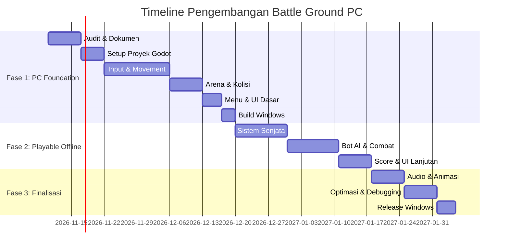

# Ringkasan Eksekutif  
Battle Ground akan dikembangkan menjadi game **Top-Down Arena Shooter 2D untuk PC Windows** (dengan ekspansi Linux/macOS nantinya) menggunakan **Godot 4** (GDScript) pada klien dan **Express + TypeScript** di backend. Tujuannya adalah memanfaatkan sebanyak mungkin kode dan desain yang ada tanpa merombak total aset mobile. Dalam rencana ini kami: melakukan audit menyeluruh repositori (fitur, prototipe, dependensi), merancang struktur proyek PC di monorepo, menyusun arsitektur client-server, dan membuat roadmap implementasi fase demi fase (utama-fitur dasar, konten, polesan, build Windows, lalu multiplayer). Dokumentasi dan kontrak data (JSON Schema) akan diperbarui sesuai kebutuhan. Hasil akhir diharapkan adalah game PC native yang dapat dijalankan di Windows (dengan build `.exe`), memiliki mekanik dasar seperti pergerakan 360°, bidikan mouse, menembak, sistem senjata, AI musuh, UI lengkap, serta fondasi multiplayer terkonsep (network, sesi, sinkronisasi).  

## Audit Repositori Battle Ground  
Sebelum pengembangan PC, repositori perlu diaudit **menyeluruh**. Berdasarkan struktur dokumen yang disebut (PRD.md, README.md, CHANGELOG.md, dokumen di `docs/`, folder `apps/mobile`, `apps/server`, `packages/shared`), beberapa poin penting:  
- **Fitur berfungsi**: Sepertinya ada gameplay 2D sederhana di Android (React Native) dengan kontrol virtual joystick, backend Express minimal. Daftar fitur (senjata, health, pergerakan, dsb) perlu dikonfirmasi melalui testing/ujicoba.  
- **Prototipe**: Banyak fitur kemungkinan masih prototipe (UI placeholder, data statis) karena target awal mobile. Misalnya, sistem multiplayer mungkin belum ada, atau hanya mockup.  
- **Fitur terencana**: Dokumen `docs/IMPLEMENTATION_PLAN.md` dan `docs/PROGRESS.md` harus ditinjau untuk fitur yang direncanakan (PC, online multiplayer, UI). Catatan roadmap atau backlog juga perlu diperiksa.  
- **Kode reuse**: Kode logika gameplay di `packages/shared` (jika ada) dapat digunakan kembali (misalnya definisi senjata, data game), serta sebagian struktur server (API, DB) tetap berguna. Algoritma AI atau utilitas di mobile juga bisa disesuaikan.  
- **Refaktor / buang-bangun baru**: Kode UI React Native tidak dipakai lagi di versi PC; bagian rendering input grafis mobile perlu di-refactor di Godot. Beberapa paket npm khusus mobile bisa dihapus. React Native Expo diganti dengan Godot, jadi sebagian besar folder `apps/mobile` bisa diarsip.  
- **Kode khusus PC**: Semua sistem visual dan input keyboard/mouse akan dibuat baru di Godot. Namun, konsep objek (player, musuh, peluru) dari mobile bisa dicermati ulang.  
- **Dependency bermasalah**: Perhatikan versi Node/Express/TS dan library yang mungkin usang di server; adaptasi mungkin perlu. Pastikan Godot 4 terinstal untuk eksport Windows (SDK Windows).  
- **Error build/lint/TS**: Lakukan kompilasi `npm run build` dan `npm run lint`. Banyak kemungkinan TypeScript error pada kode jika TypeScript dikonfigurasi ketat. Pastikan semua skrip backend lulus tes.  

Dokumen hasil audit ditulis di `docs/PC_MIGRATION_AUDIT.md`, mencakup temuan di atas. Audit tidak boleh menghapus implementasi mobile saat ini (untuk menjaga arsip), tapi fokus menemukan apa yang reusable dan apa yang perlu dibuat baru di PC.

## Arsitektur dan Struktur Proyek PC  
**Game Engine:** Godot 4.x (2D engine) dengan **GDScript** sebagai bahasa game. Godot mendukung ekspor PC Windows dengan menyatukan aset ke dalam `data.pck` dan binary kecil.  
**Struktur folder:** Menambahkan `apps/pc-client/` untuk proyek Godot dan menyimpan kembali `apps/server/` serta `packages/shared/` untuk backend/arsip. Contoh struktur awal:

``` 
battle_ground/
├── apps/
│   ├── mobile/        # legacy mobile (arsip)
│   ├── pc-client/
│   │   ├── project.godot
│   │   ├── scenes/ (Main.tscn, Arena.tscn, dsb)
│   │   ├── scripts/ (Player.gd, Enemy.gd, UI.gd, ...)
│   │   ├── assets/  (image, sprite, audio, dll)
│   │   ├── resources/ (pengaturan, dsb)
│   │   ├── tests/ (unit/integration)
│   │   └── export_presets.cfg
│   └── server/       # Express + TS backend (API, multiplayer)
├── packages/          # workspace packages
│   ├── shared/       # shared libraries/util
│   ├── protocol/     # JSON Schema kontrak data
│   └── game-data/    # konfigurasi senjata, map, karakter
├── docs/             # dokumentasi proyek (ditambah PC_)
└── README.md
```

**Teknologi Utama:**  

| Komponen         | Teknologi / Tool                        |
|------------------|-----------------------------------------|
| Game Engine      | Godot Engine 4.x (open source, 2D) |
| Bahasa Game      | GDScript (scripting Godot)              |
| Client Platform  | Windows 64-bit (Desktop)                |
| Backend          | Node.js + Express (TypeScript) |
| Database         | PostgreSQL (untuk data pemain/score)    |
| Networking       | WebSocket (Socket.IO)      |
| Protokol Data    | JSON (kontrak via JSON Schema) |
| Build            | Godot Export (Windows build `.exe`) |

Godot 4 dipilih karena sangat cocok untuk game 2D ringan dan multiplatform (Windows, macOS, Linux), serta integrasi mudah untuk keyboard/mouse. Backend Express/TS tetap dipakai untuk layanan akun dan multiplayer. *React Native* mobile dipertahankan hanya sebagai legacy/arsip; fokus saat ini adalah klien PC.

**Integrasi Backend:** Godot mengirimkan data JSON ke server (Socket.IO/HTTP) sesuai skema kontrak di `packages/protocol`. Server akan menjaga autoritativeness (walau fase awal offline hanya untuk testing). Semua logika sensitif (damage, skor) hanya di-hitung server kemudian disinkronkan ke klien.  

## Rencana Implementasi Fase 1 (PC Foundation)  
Fase 1 bertujuan membangun fondasi gameplay dasar PC. Setiap tugas memiliki kriteria penerimaan (acceptance criteria) dan estimasi waktu pengerjaan (jam).  

| Tugas                                   | Kriteria Penerimaan                                         | Estimasi (jam) |
|-----------------------------------------|-------------------------------------------------------------|---------------|
| **Audit dan Dokumentasi**               | Hasil audit ditulis di `docs/PC_MIGRATION_AUDIT.md` dengan temuan (fitur/code reuse) | 8             |
| **Setup Proyek Godot**                  | Folder `apps/pc-client/` berisi `project.godot` dan struktur scenes/, scripts/, assets/; proyek dapat dibuka di editor | 6             |
| **Sistem Input WASD+Mouse**             | Pemain dapat bergerak 360° menggunakan WASD; mouse mengarahkan bidikan; kontrol responsif | 12            |
| **Controller Pemain (Movement+Camera)** | Node Player (KinematicBody2D) berjalan, melompat/dash (jika ada), dan `Camera2D` mengikuti karakter | 12            |
| **Arena dan Kolisi**                    | Tersedia satu *map* arena (batas, dinding, obstacle); spawn point pemain; kolisi berfungsi (tidak keluar arena) | 16            |
| **Main Menu & UI Dasar**                | Menu utama tampil dengan tombol Play/Settings/Exit (fungsional); HUD dasar (health, kill count) | 8             |
| **Build Windows (Development)**         | Ekspor build Windows (`.exe` dan data.pck) berhasil; aplikasi dapat dijalankan tanpa editor | 4             |
| **Dokumentasi & Rencana Fase 2**        | README diperbarui cara build PC; daftar tugas untuk fase 2 (lihat PC_IMPLEMENTATION_PLAN) | 4             |

_Pengujian untuk diterima:_ Setelah fase ini selesai, game PC versi development harus **dapat dijalankan di Windows**, pemain dapat bergerak bebas di arena dengan keyboard/mouse, dan setidaknya satu skenario pertandingan (offline melawan bot) bisa dimainkan sampai akhir sederhana. Semua bug blocking (error runtime) harus diperbaiki.  

## Pemetaaan Fitur Gameplay ke Subsystem Godot  
Berikut pemetaan fitur-fitur utama game ke subsistem Godot:  

- **Input (Keyboard & Mouse):** Gunakan **InputMap** Godot untuk definisi tombol (WASD, mouse) yang dapat dikonfigurasi. Skrip akan membaca input melalui `_input(event)` atau `_process()`.  
- **Player Movement & Physics:** Gunakan `KinematicBody2D` (atau `CharacterBody2D`) untuk pemain dan musuh agar mudah menangani movement dan collision (`move_and_slide`). Fisika dasar Godot (Physics2D) mengurus kolisi dengan dinding dan obstacle.  
- **Shooting & Projectiles:** Bisa gunakan `Area2D` atau `RigidBody2D` kecil untuk peluru. Ketika menembak, spawn node peluru dengan kecepatan dan arah mouse. Collision untuk peluru menggunakan `CollisionShape2D`.  
- **AI Musuh:** Buat musuh (Enemy KinematicBody2D) dengan *finite state machine* (idle, patroli, kejar, serang). Logika AI ditulis di GDScript menggunakan `_physics_process()` atau `StateMachine` sederhana.  
- **Game State & Rules:** Node global (misal `GameController`) mengelola ronde/score. Semua aturan (health, damage, reload) terpusat di skrip ini. Hindari duplikasi aturan; gunakan `packages/shared` untuk parameter game (contoh: damage senjata, kecepatan).  
- **UI (Hud & Menu):** Gunakan node `CanvasLayer` dengan kontrol UI (Control, Label, Button). Godot punya sistem layout dan tema. Buat HUD dengan health bar, ammo count, kill counter, timer. Menu utama di scene terpisah.  
- **Audio:** Gunakan `AudioStreamPlayer2D` untuk efek suara (tembakan, kena damage) dan `AudioStreamPlayer` untuk musik latar. Mix dengan Audio Bus.  
- **Resource/Asset Management:** Godot menggunakan file `.tscn`, `.tres`. Masukkan aset gambar, sprite, tilemap ke folder `assets/`. Bisa gunakan TileMap untuk peta modular.  
- **Networking (ke depan):** Godot 4 menyediakan high-level multiplayer API berbasis `MultiplayerAPI` dalam `SceneTree`. Default menggunakan ENet (UDP). Ketika menyiapkan multiplayer, server akan dijalankan di Node.js (Socket.IO/WebSocket), dan Godot Client dapat dihubungkan via `WebSocketMultiplayerPeer`. (Fitur ini adalah fase lanjutan.)  

Dengan pemetaan ini, pengembangan fitur baru di Godot akan mengikuti arsitektur engine. Dokumentasi Godot (mis. **High-Level Multiplayer** dan **Profiler**) dapat dijadikan referensi teknis.  

## Kontrak JSON Schema (packages/protocol)  
Semua komunikasi dan data game yang dibagikan antar komponen akan didefinisikan dalam format JSON Schema (packages/protocol). JSON Schema memastikan struktur data konsisten dan tervalidasi. Beberapa kontrak penting diantaranya:  

- **PlayerMove**: Pergerakan pemain – mengandung `playerId`, `posisi: {x, y}`, dan `rotasi` (arah bidikan).  
- **ShootEvent**: Tembakan – berisi `playerId`, `weaponId`, `direction: {x,y}`, `isAutomatic: bool`.  
- **DamageEvent**: Serangan – berisi `shooterId`, `targetId`, `damageAmount`.  
- **HealthUpdate**: Status kesehatan – `playerId`, `newHealth`.  
- **ScoreUpdate**: Perubahan skor – `playerId`, `kills`, `deaths`.  
- **MatchState**: Status pertandingan (mulai/selesai) – `matchId`, `state: "START"/"END"`, `winnerId` (jika ada).  
- **Auth/Login** (backend): `username`, `password`, dan respons token JWT jika berhasil.  

Setiap skema ini disimpan di `packages/protocol` dan digunakan di server dan client (dari TypeScript/TS atau GDScript) untuk validasi data. Misalnya, menggunakan [@rollup/plugin-jsonschema](https://json-schema.org/) atau library validasi JSON. Dengan kontrak yang jelas, front-end Godot dan back-end dapat sepakat format data tanpa miskomunikasi.  

## Pengujian dan Quality Control  
Setiap fase harus melalui pengujian yang ketat:  

- **Build Verifikasi:** Pastikan proyek Node/TS lulus `npm run build`, tidak ada error TS/ESLint. Pastikan build Godot tanpa error.  
- **Unit & Integrasi (Back-end):** Backend Express diuji dengan unit test (misal Jest/Mocha) untuk API penting. Shared library (`packages/shared`) juga diuji (contoh: perhitungan damage sama di client/server).  
- **Validasi Godot:** Jalankan project di editor dan periksa tab Debugger/Output untuk error. Gunakan *Playtesting* sederhana (run project dari Godot).  
- **Smoke Test Windows:** Ekspor ke Windows (development), jalankan `.exe` di OS target. Cek tidak crash saat memulai/keluar.  
- **Pengujian Gameplay:** Verifikasi fitur inti: pergerakan, bidikan, tembak, spawn, AI sederhana. Mode latihan (vs bot) harus bisa dimainkan dari awal sampai akhir.  
- **Profiling & Kinerja:** Gunakan profiler Godot untuk memeriksa *frame rate*, *frame time*, CPU, memori. Pastikan tidak ada frame drop besar. Optimasi secukupnya (collision shape sederhana, sprite atlas, dsb).  
- **Uji Jaringan (fase multiplayer):** Setelah menyiapkan socket, lakukan simulasi latensi dan bandingkan posisi di client-server. Cek *prediction* latency, *cheating prevention*. (Streaming data player/match lewat Socket.IO).  

Checklist ini dimasukkan ke `docs/PC_TESTING.md` dan dilakukan secara rutin. Error tersisa dicatat di issue tracker (GitHub) untuk perbaikan sebelum moving on ke fase berikutnya.

## Deliverables Fase 1 & 2  
- **Fase 1 – PC Foundation:**  
  1. Proyek Godot PC (`apps/pc-client`) dengan struktur lengkap.  
  2. Main Menu dasar dan scene Arena playable.  
  3. Player Character berfungsi: kontrol WASD, aiming mouse, kamera follow.  
  4. Arena dengan boundary dan kolisi.  
  5. Build Windows development (`.exe`).  
  6. Dokumen `docs/PC_MIGRATION_AUDIT.md`, panduan build PC di README.  
  7. Daftar pekerjaan Fase 2.  
- **Fase 2 – Playable Offline Match:**  
  - Sistem senjata: reload, ammo, tipe senjata.  
  - Proyektil & efek peluru (visual/audio).  
  - AI Bot sederhana (patrol, chase, attack, death).  
  - Health, damage, respawn (mode latihan).  
  - Sistem pertandingan: score counter, kill feed, victory/defeat screen.  
  - UI dan VFX finalisasi dasar (crosshair, damage flash, dll).  

Deliverables Fase 2 meliputi game offline playable penuh satu match, dokumentasi gameplay (`docs/PC_GAMEPLAY.md`), dan transisi kesiapan ke networked multiplayer.

## Daftar Isu GitHub (Issue Tracker)  
Berikut contoh beberapa isu yang perlu dibuat (dengan judul, deskripsi singkat, label, prioritas):  

| Judul Issue                     | Deskripsi Singkat                                                     | Label                | Prioritas |
|---------------------------------|-----------------------------------------------------------------------|----------------------|-----------|
| Audit kode untuk migrasi PC     | Audit semua file & fitur yang ada; buat `docs/PC_MIGRATION_AUDIT.md`   | `documentation`      | High      |
| Buat proyek Godot PC client     | Inisialisasi Godot 4 project di `apps/pc-client` dengan struktur awal  | `enhancement`        | High      |
| Implementasi kontrol WASD+Mouse | Buat script `Player.gd` untuk movement WASD dan aiming dengan mouse    | `feature`            | High      |
| Buat scene Arena dengan kolisi  | Desain satu map arena dengan batas, obstacle, dan spawn point pemain    | `feature`, `2D`      | High      |
| Setup camera follow pemain      | Tambahkan `Camera2D` ke scene agar mengikuti pergerakan player          | `feature`            | Medium    |
| Main Menu UI sederhana          | Tambahkan menu utama dengan tombol Play/Settings/Exit (fungsional)     | `UI`, `low-hanging`  | Medium    |
| Ekspor build Windows            | Konfigurasi export preset untuk Windows; verifikasi `.exe` berjalan     | `build`              | Medium    |
| Implementasi sistem senjata     | Kembangkan inventory senjata, ammo, reload, dan efek tembakan           | `feature`            | High      |
| Kembangkan AI bot dasar         | Tambah bot dengan state IDLE, PATROL, CHASE, ATTACK, dan respawn       | `feature`, `AI`      | High      |
| Penambahan suara & VFX          | Tambahkan efek suara (tembakan, langkah) dan animasi/damage effect     | `improvement`        | Low       |

Isu-isu ini dibuat di GitHub repository (dengan label seperti `feature`, `bug`, `UI`, `documentation` sesuai jenis, dan prioritas `High/Medium/Low`). Setiap isu mencakup link relevan bila perlu (mis. referensi file di repo).  

## Prompts/Snippets untuk Coding Agent  
Berikut adalah contoh _prompt_ yang siap dijalankan oleh coding agent (Antigravity/GPT-4) untuk tugas-tugas tertentu:

```text
# Prompt 1: Buat proyek Godot PC
Buatlah proyek Godot 4 di folder 'apps/pc-client' (memakai Godot CLI atau manual), dengan file 'project.godot' utama. Sertakan folder 'scenes/', 'scripts/', 'assets/', dan 'resources/' sesuai struktur. Jangan hapus folder lama.

# Prompt 2: Setup folder scenes
Di proyek Godot 'apps/pc-client', buat scene 'Main.tscn' (Node2D root) beserta subfolder 'Arena/' dan 'Player/'. Tambahkan node Camera2D (set current), dan node KinematicBody2D bernama 'Player'. Assign script 'Player.gd' ke Player.

# Prompt 3: Implementasi Player controller
Di file 'Player.gd', tambahkan kode GDScript untuk input keyboard (WASD) dan pergerakan 360°: tangkap Input.is_action_pressed("ui_up/down/left/right") menggunakan InputMap. Gunakan move_and_slide() untuk gerakan; rotasi sprite ke arah mouse (`get_global_mouse_position()`). Pastikan InputMap mendefinisikan "move_up", "move_down", dsb.

# Prompt 4: Arena dan kolisi
Buat scene 'Arena.tscn' dengan Node2D root. Tambahkan TileMap atau StaticBody2D dengan CollisionShape2D sebagai batas dinding. Pastikan Collider membentuk area tertutup. Tempatkan Player spawn position di tengah arena.

# Prompt 5: Build Windows
Di Godot, buka Project > Export, tambahkan preset Windows Desktop. Konfigurasi path output. Jalankan ekspor untuk membuat .exe. Verifikasi file executablenya dapat dijalankan di Windows (tanpa editor). Jika perlu, sesuaikan `export_presets.cfg` dan instal Windows SDK.

# Prompt 6: Proyek backend (opsional fase selanjutnya)
Tambahkan endpoint Express baru untuk multiplayer matchmaking (contoh: POST `/matchmaking`), dengan validasi input menggunakan JSON Schema dari `packages/protocol`. Buat dokumentasi stub di `docs/PC_MULTIPLAYER.md`.
```

Kode di atas dapat diberikan ke agen coding seperti *Antigravity* untuk langsung membuat file Godot/script yang diperlukan. Pastikan setiap prompt menjelaskan dengan jelas tugas dan hasil file yang diharapkan.  

## Diagram Arsitektur & Timeline  
Arsitektur keseluruhan Battle Ground PC digambarkan sebagai berikut:  

```mermaid
flowchart LR
    PC[Godot PC Client] -- WebSocket/UDP --> Server[(Node.js Express<br>+ Socket.IO)]
    Server --> DB[(PostgreSQL)]
    PC -- JSON Data --> Protocol[(Packages/protocol)]
    Server -- JSON Data --> Protocol
    Mobile[Legacy Mobile (RN)] -.-> |Arsip| PC
```

Dan contoh garis waktu pengembangan (Gantt chart) untuk beberapa fase utama:  



## Referensi  
- Dokumentasi **Godot Engine**: Export Windows, Multiplayer API, Profiler.  
- **JSON Schema** (kontrak data): menjamin konsistensi JSON.  
- **TypeScript**: memperkaya JavaScript dengan tipe untuk proyek skala besar.  
- **Socket.IO** (WebSocket realtime): komunikasi dua-arah, otomatis fallback bila perlu.  
- **Express.js**: framework minimal untuk web/API di Node.js.  

Referensi utama (Godot, JSON Schema, Socket.IO, TypeScript, Express) mendukung pemilihan teknologi dan tata kelola data dalam rencana ini. Dengan roadmap di atas, tim dapat memulai implementasi fase demi fase secara terstruktur, memastikan Battle Ground PC memiliki fondasi gameplay yang kuat dan siap dikembangkan ke fitur online.