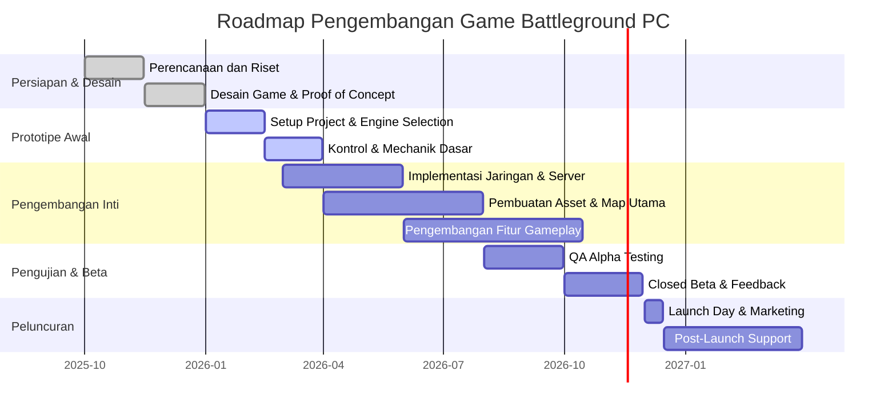

# Ringkasan Eksekutif  
Battle royale adalah genre game di mana puluhan hingga ratusan pemain bertarung dalam arena yang **menyusut** secara dinamis. Proyek *battle_ground* diarahkan menjadi game battleground PC, yang menuntut fitur seperti peta luas, zona aman bergerak, loot senjata, kendaraan, dan dukungan multiplayer real-time. Namun, informasi repositori aslinya tidak tersedia secara publik. *Asumsi*: proyek awal mungkin berbasis Unity/C# atau Unreal/C++ untuk mobile; perlu porting besar-besaran ke PC. Laporan ini menyajikan analisis teknis, kebutuhan tambahan, dan roadmap pengembangan. Rencana mencakup pemilihan engine (Unity, Unreal, atau Godot), arsitektur jaringan client-server, integrasi anti-cheat (EAC/VAC/BattlEye), platform monetisasi (Steam, Epic), dan kebutuhan QA/CI. Kami menyarankan fase-fase kunci: *perencanaan dan pra-produksi*, *pengembangan prototipe/mid-fidelity*, *integrasi jaringan dan pengujian*, hingga *peluncuran dan live-ops*. Setiap fase diberi estimasi waktu (berbulan), sumber daya (bujet atau SDM), dan mitigasi risiko. 

## Analisis Repositori dan Teknologi (Asumsi)  
Karena tidak ada akses publik ke kode, analisis repositori bersifat **asumsi**. Diperkirakan struktur awal mungkin mencakup beberapa modul: logika gameplay (movement, senjata, loot), UI sederhana, asset environment, dan (mungkin) plugin/SDK jaringan dasar. Bahasa pemrograman dan framework tergantung engine: jika Unity, C# dan *Unity Editor*; jika Unreal, C++ dan *Unreal Editor*; jika Godot, GDScript/C#. Lisensi engine: Unity gratis jika pendapatan <\$200k per tahun, lalu langganan ~\$2.2k per lisensi; Unreal free sampai \$1M pendapatan lalu 5% royalti; Godot gratis & open-source tanpa royalti. Tanpa informasi spesifik, sulit tahu aset apa yang sudah dibuat (3D model, suara, animasi). Fitur gameplay inti belum diketahui detailnya; kemungkinan belum selesai mengimplementasikan jaringan, GUI desktop, atau kontrol keyboard/mouse. *Asumsi utama:* perlu migrasi lengkap ke environment PC, menambahkan dukungan input PC, perbaikan UI/UX, serta sistem multiplayer server-authoritative. Semua aspek ini harus direncanakan dari nol kecuali jika ditemukan modul siap-pakai di repositori.

## Fitur Gameplay Inti & Kebutuhan Tambahan PC  
Game battleground PC seharusnya mencakup:  
- **Peta multiplayer besar** (puluhan–100+ pemain) dengan elemen skid-safe zone dan point of interest untuk eksplorasi dan pertempuran.  
- **Loot & Inventarisasi**: senjata/armor acak, drop crate, sistem loot dasi di map.  
- **PVP Real-time**: tembakan balistik/senjata, mekanik beragam (arah pandang bebas, ADS, recoil).  
- **Squad & Komunikasi**: dukungan tim hingga 4 orang, chat suara/teks.  
- **Sistem fungsionalitas mobile ke PC**: UI adaptif (resolusi tinggi, full screen), kustomisasi kontrol (keyboard/mouse, gamepad), grafik skala PC.  
- **Fitur sosial**: lobi/matchmaking antar pemain, leaderboard, skin/kosmetik (jika F2P).  

Fitur saat ini di repositori kemungkinan masih minimal. Fitur kritis yang *perlu ditambah* antara lain: dukungan PC controller (mouse+keyboard), mode windowed/fullscreen, interface desktop (menu utama, HUD lengkap), penyimpanan progres akun (database profil), dan infrastruktur server yang layak. Selain itu perlu evaluasi performa (frame rate, CPU/GPU usage) untuk memastikan pengalaman lancar di PC. Genre ini juga memerlukan fitur kualitatif: deathmatch, statistik pertandingan, dan sistem anti-cheat. 

## Arsitektur Performa & Jaringan  
Game multiplayer besar **harus** menggunakan arsitektur client–server untuk kestabilan dan keamanan. Tidak dianjurkan model peer-to-peer karena NAT traversal dan cheat. Misalnya, Photon Engine menyatakan *“All Photon Cloud products are based on a client to server architecture, the most stable solution for multiplayer games”*. Solusi jaringan umum untuk Unity meliputi Photon (PUN/Fusion), Mirror (open-source), atau Epic Online Services. Photon PUN/populer di game FPS karena setup mudah dan cloud hosting terkelola. Mirror (fork UNet) bersifat open-source, fleksibel untuk MMO besar, tetapi perlu hosting sendiri (server dedicated). Azure PlayFab atau AWS GameLift bisa digunakan untuk backend dan matchmaking, dengan prosesor latar (untuk fisika, validasi) yang dihosting di cloud.

**Skalabilitas & Latency:** Cloud networking multi-region direkomendasikan: server di APAC (mis. Singapura) untuk latensi rendah bagi pemain Asia. Desain arsitektur harus memperhitungkan *tickrate* tinggi (~30-60 Hz) untuk game tembak-menembak, serta optimasi *bandwidth* (kompresi paket, spacial partitioning). Photon atau engine sejenis menyediakan load balancer otomatis dan monitoring 24/7. 

**Teknologi Jaringan Populer:**  
- *Photon PUN/Fusion* (Unity) – gratis hingga ~20 CCU, model master-client fallback, cocok prototyping.  
- *Mirror* (Unity) – gratis, sangat kustom, cocok skala MMO, memerlukan server sendiri.  
- *Epic Online Services (EOS)* – gratis, cross-platform (PC/konsole), menyediakan lobbies, stats, anti-cheat (EasyAntiCheat) melalui SDK Epic.  
- *Steamworks Networking* – bagi rilis di Steam, mendukung matchmaking dan SDXP (Steam Datagram Relay).  
- *Dedicated Server (kustom)* – opsi buat game besar, full kontrol state; biaya tinggi (AWS/GCP) namun optimal untuk cheat resistance.  

## Keamanan dan Anti-Cheat  
Keamanan sangat penting di game kompetitif. Platform seperti Steamworks menyediakan integrasi anti-cheat (VAC) dan sistem ban. Selain itu, opsi populer termasuk **EasyAntiCheat (EAC)** (digunakan banyak game besar, gratis bagi publisher yang sudah bayar Epic Engine) dan **BattlEye** (komersial, banyak digunakan di FPS). Strategi umum: server-authoritative logic untuk validasi posisi/tembakan, enkripsi data sensitif, serta *obfuscation* pada client untuk mencegah modifikasi. Selain itu, implementasi cheat detection (runtime memory scan, analisis pola) serta patch update cepat sangat penting. Layanan pihak ketiga (EAC/BattlEye) dapat diintegrasikan sebelum rilis. *Steamworks* memudahkan penerapan VAC bila di-publish melalui Steam.  

## Monetisasi dan Distribusi  
Untuk PC, platform rilis utama adalah **Steam** dan **Epic Games Store**. Steam dominan pasar PC, menawarkan dukungan lengkap (Steam Store, achievements, workshop) dan mengambil ~30% pendapatan. Epic Store memberi **88% ke pengembang, 12% ke Epic** di atas \$1 juta (dengan 100% bagi \$1 juta pertama tiap tahun). Epic sering menawarkan promosi/insentif untuk eksklusivitas jangka pendek. 

Contoh mekanisme monetisasi dalam game: model free-to-play (F2P) dengan *in-app purchase* skin/microtransactions lewat Steam Inventory, battle pass, atau premium pass satu kali (DLC). Perlu riset hukum (peraturan pemerintah RI) untuk in-game currency atau sistem gacha. Selain Steam/Epic, platform lain: GOG (DRM-free, 85/15 revenue), itch.io (indie friendly, fleksibel). Pilihan distribusi juga meliputi **Steam Deck Ready** agar sesuai pasar di Indonesia.  

## Isu Hukum, IP, dan Lisensi  
Perhatikan kepemilikan IP: pastikan semua aset (grafik, suara) bebas lisensi atau dikelola dengan benar. Jika menggunakan engine pihak ketiga: patuhi *EULA*. Unity dan Godot memungkinkan ekspor bebas royalti; Unreal mengenakan 5% di atas \$1M pendapatan. Jika ingin monetisasi, perlu memperhatikan perizinan musik (royalty-free atau komposer sendiri). Untuk distribusi di Indonesia, periksa regulasi sensor game (LSF Indonesia) dan pelaporan pajak digital.  

Lisensi kode: jika repositori berlisensi open source (tidak diketahui), perlu konfirmasi. Rencana konten live-ops (skin, DLC) juga harus menghindari pelanggaran hak cipta.  

## QA, Pengujian, dan CI/CD  
Sistem pengujian harus komprehensif: **unit test** untuk logika (fisika, loot, matchmaking), **integrasi test** untuk modul jaringan, dan **pengujian fungsional manual** (gameplay, UI). Menurut panduan QA, fase testing perlu menutup bug teknis (softlock, rendering, performa) dan *“fun factor”*. Pengujian keamanan (penetration test cheat) juga disarankan.

Rangkaian CI/CD (Continuous Integration) mencakup: 
- **Source Control**: Git/GitHub dengan branching (dev, staging, main).  
- **Build Otomatis**: Unity Cloud Build, GitHub Actions, atau Jenkins untuk membangun (build) game di platform PC/Xbox/PlayStation secara otomatis pada commit.  
- **Automated Testing**: Unity Test Runner/NUnit untuk script, serta smoke test saat build baru.  
- **Deployment**: Mengatur pipeline deploy ke Steam Early Access/Playtest branch saat milestone stabil.

Metode **Agile** direkomendasikan: selalu sedia build berjalan untuk feedback cepat. Prioritaskan fitur *MVP* dalam tiap *sprint*, lalu iterasi berdasarkan umpan balik pengguna. Dengan proses ini, *“selalu memiliki build yang berjalan dan mendapat umpan balik nyata”*. Bug tracker (Jira/Trello) penting untuk melacak issue.  

## Peran Tim & Estimasi Usaha  
Tim ideal minimal meliputi: 
- **Game Designer/Project Lead** (mendesain game loop, memimpin tim).  
- **Programmer Unity/Unreal (2–3 orang)** – gameplay, engine, sistem backend, jaringan.  
- **Network Engineer (1)** – setup server (Cloud/Photon), optimasi koneksi, keamanan.  
- **3D Artist/Animator (2)** – karakter, environment, efek.  
- **UI/UX Artist (1)** – antarmuka HUD, menu, icon.  
- **Sound Designer/Musik (1)** – efek suara, musik latar.  
- **QA Tester (1–2)** – pengujian fungsional dan regresi.  
- **DevOps/Cloud Engineer (1)** – pengelolaan server, deployment CI/CD, monitoring.  

Estimasi usaha: proyek game battleground skala menengah–besar umumnya memakan 12–24 bulan pengembangan penuh dengan tim ~5–10 orang, ditambah pasca-peluncuran berkelanjutan. Estimasi biaya: pengembang Indonesia berpenghasilan ~50–100 juta IDR/bulan. Sebagai gambaran kasar:  
- **Solo/Indie**: 6–12 bulan (1 orang) – biaya tenaga ~300–600 juta IDR;  
- **Tim Kecil (3–6 orang)**: 12–18 bulan – biaya ~1–3 miliar IDR;  
- **Studio (10+ orang)**: 18–36 bulan – biaya puluhan miliar IDR.  

(Angka di atas sangat dipengaruhi cakupan fitur, gaji, dan overhead. Tanpa data akurat, perkirakan rentang lebar.)

## Pilihan Engine dan Teknologi  
**Engine Utama:**  
| Engine   | Bahasa      | Lisensi/BIaya                       | Kelebihan                         | Kekurangan                    |
|----------|-------------|-------------------------------------|-----------------------------------|-------------------------------|
| **Unity**    | C#          | Gratis sampai \$200k/yr, lalu subskripsi | *Cross-platform luas*, banyak tutorial, asset store kaya | Kinerja butuh optimasi ekstra, kualitas grafis menengah |
| **Unreal**   | C++, Blueprints | Gratis sampai \$1M pendapatan, lalu 5% royalti | *Grafis AAA*, sistem fisika animasi komplet, blueprint visual | Steep learning, memerlukan komputer kuat, overkill untuk 2D/sederhana |
| **Godot**    | GDScript, C#   | 100% gratis, open-source       | *Ringan*, 100% gratis, mudah dipelajari, baik untuk 2D | 3D masih di belakang Unity/Unreal, komunitas lebih kecil |
| **Kustom** (Engine sendiri) | C++/bebas  | SDM besar, biaya R&D tinggi         | Kontrol penuh arsitektur, bebas royalti  | Biaya & waktu pengembangan sangat tinggi, maintenance susah |

Referensi biaya lisensi: Unity bebas sampai ambang tertentu, Unreal mengambil 5% di atas \$1 juta. Godot tidak memungut apapun.  

**Kesimpulan:** Jika tim berpengalaman C#, Unity atau Godot lebih cepat. Untuk grafis menawan dan kontrol maksimal di PC, Unreal unggul. Godot cocok jika anggaran sangat terbatas.   

## Pipeline Asset, UI/UX, Aksesibilitas, Lokalisasi  
- **Pipeline Asset:** Gunakan software umum (Blender/3ds Max untuk 3D, Photoshop/GIMP untuk tekstur). Kelola versi asset (mis. *Git LFS* untuk file besar). Terapkan *LOD* dan *Occlusion Culling* untuk kinerja.  
- **UI/UX**: Desain HUD dan menu dengan skala yang dapat diubah, kontra tinggi, dan navigasi keyboard/mouse. Sesuaikan font dan tombol agar mudah dibaca/diakses (mis. angka besar untuk HP, indikator cooldown).  
- **Aksesibilitas:** Tambahkan fitur seperti *closed captions*, *mode buta warna*, *remappable controls*, dan dukungan controller adaptif. Panduan Game Accessibility merekomendasikan memasukkan fitur-fitur ini sejak awal. Ini penting untuk menjangkau pemain difabel (15% populasi) dan meningkatkan retensi pengguna.  
- **Lokalisasi:** Sediakan bahasa Indonesia (teks & suara) untuk pasar lokal. Engine modern (Unity, Unreal) mendukung paket bahasa (localization frameworks). Rencanakan teks yang terpisah dari kode agar mudah diterjemahkan.  

## Rencana Live-Ops Pasca-Peluncuran  
Setelah rilis, rencana live-ops mencakup: perbaikan bug cepat (patch), *balancing* gameplay, konten baru (map, senjata, event), dan dukungan komunitas. Gunakan analytics (Unity Analytics / PlayFab / GameAnalytics) untuk memantau metrik retensi/monetisasi. Siapkan *continuous deployment* untuk update harian/mingguan jika perlu. Integrasi sistem feedback (forum, bug report di Steam). Untuk server, gunakan layanan cloud hosting yang dapat autoscale (AWS/GCP/Azure) dan monitoring uptime (mendorong SLA 99.9%).  

## Roadmap Pengembangan (Mermaid Gantt Chart)  

**Milestones Utama:** Proof-of-Concept (Des 2025), Prototipe MPC (Maret 2026), Alpha Stabil (Sept 2026), Beta Akhir (Nov 2026), Rilis Publik (Des 2026).  
**Estimasi Waktu:** Setiap fase 2–4 bulan.  
**Sumber Daya:** Skala SDM rendah (solo), sedang (tim 4-6), tinggi (studio besar) pada masing-masing fase.  
**Risiko:** Kompleksitas multiplatform (rating tinggi); integrasi jaringan (sedang); keamanan/cheat (tinggi); manajemen konten (sedang).  

## Rencana Migrasi dan Peningkatan Teknis  
Langkah teknis penting:  
- **Refaktor Kode:** Tinjau struktur kode lama. Pisahkan logika perangkat mobile (mis. touchscreen) dari input PC.  
- **Migrasi Engine:** Jika repositori berbasis Android native (Kotlin/Java), pertimbangkan migrasi ke Unity/Unreal. Untuk proyek Unity lama, upgrade ke versi LTS terbaru.  
- **Sistem Jaringan:** Tentukan stack networking. Misalnya, integrasikan Photon SDK atau Mirror; ubah arsitektur menjadi client-server dengan authoritative host. Sesuaikan event multiplayer agar work untuk >50 pemain.  
- **Input & Kontrol:** Tambahkan dukungan Mouse/Keyboard dan gamepad. Gunakan sistem input bawaan (Steam Input/Unreal Input System) untuk mapping tombol.  
- **Build Config untuk PC:** Setup target build Windows (32/64-bit), dan sertakan depedensi (DLL VC++, redist). Jika multi-OS (Linux/Mac), siapkan cross-compile pipeline.  
- **Integrasi Platform:** Persiapkan integrasi Steamworks/Epic Online Services (SDK). Sertakan sistem login dan achievement sesuai platform.  

## Rekomendasi Alat, Library, dan Layanan  

| Kebutuhan         | Contoh Alat/Layanan         | Kelebihan                                      | Kekurangan                 |
|-------------------|-----------------------------|-----------------------------------------------|---------------------------|
| **Matchmaking / Server**  | Photon Fusion/PlayFab/SmartFox | *Photon*: cepat dan terkelola (Cloud), C# friendly; *PlayFab*: komprehensif (MS Azure) | *Photon*: biaya >CCU gratis; *PlayFab*: bergantung Azure |
|                   | AWS GameLift/Google Agones    | Dedicated server, autoscaling (skala besar), latensi rendah  | Biaya tinggi (per-jam)    |
| **Voice Chat**    | Vivox (Unity), Steam Voice    | *Vivox*: terintegrasi (Unity/Unreal), spatial voice, free*; *Steam Voice*: mudah jika platform Steam | *Vivox*: setup kompleks; *Steam*: hanya di Steam       |
| **Analitik / Telemetri** | Unity Analytics/UGS, Firebase, GameAnalytics | Insight retention/ARPU gratis {Unity Analytics deprecated?}, *GameAnalytics*: gratis populasi kecil; *Firebase*: realtime database mudah, crashlytics | Google Analytics bisa privacy, limit data; biaya untuk data besar |
| **Anti-Cheat**    | EasyAntiCheat, BattlEye, Valve VAC | *EAC*: banyak dukungan, dibuat Epic; *BattlEye*: banyak digunakan di shooter; *VAC*: otomatis di Steam | *EAC/BattlEye*: biaya lisensi; *VAC*: hanya di Steam      |
| **Hosting / Cloud**   | AWS, Azure, GCP, Multiplay  | *AWS/Azure*: global, banyak layanan (GameLift, PlayFab); *Multiplay (Ubisoft)*: fokus game, siap produksi | Kompleks, biaya variatif; setup rumit                 |

*Catatan:* Vivox kini diakuisisi Unity, sering gratis bagi dev game. PlayFab dan GCP menawarkan free tier untuk permulaan.  

## Fitur Minimum Viable & Stretch Goals  
**Minimum Viable:** multiplayer 20-50 pemain, satu map (simulasi pulau), sistem loot, senjata dasar, voice chat, menu utama, akun login sederhana. Grafik 3D (dapat placeholder), UI fungsional, server dedicated/room networking.  
**Stretch Goals:** beberapa map/lingkungan, kustomisasi karakter, kendaraan, event musiman, sistem progres akun (battle pass), cross-play (PC/Console), fitur sosial (clan/guild), mod support (Steam Workshop).  

## Estimasi Biaya  
Tanpa data final sulit tepat. Berikut *perkiraan kasar* (IDR):  
- **Solo (1 dev, 6–12 bulan):** 100–500 juta (gaji + lisensi/tk). Effort Low; risiko tinggi karena SDM terbatas.  
- **Tim Kecil (3–6 dev, 12–18 bulan):** 1–3 miliar. Effort Medium; lebih banyak spesialisasi (SDM, QA, art).  
- **Studio Besar (10+ dev, 18–30 bulan):** 5–15 miliar+. Effort High; manajemen kompleks, kualitas AAA, risiko menurun dengan tim berpengalaman.  

## Pengujian & Rencana CI/CD  
Rencana pengujian: Buat *test plan* meliputi: unit test (logika loot/jaringan), playtest internal, closed beta tester, dan automated smoke test setiap nightly build. Library tes: NUnit (Unity), atau Google Test (Unreal). Gunakan *CI/CD pipelines* (misal GitHub Actions) untuk build otomatis, menjalankan unit tests, dan deploy ke branch pengujian. Setup *staging server* untuk uji integrasi multiplayer. Pull request harus review kode, serta regression test sebelum merge.  

## Contoh Struktur File/Folder & Build/Deploy  
Contoh (dalam Unity):  
```
/Assets
  /Scripts        (kode C#)
  /Scenes         (level & menu)
  /Prefabs        (objek siap pakai)
  /Art            (model, tekstur)
  /UI             (canvas, gambar UI)
  /Plugins        (SDK Photon/Vivox/Steam)
/ProjectSettings
.gitignore
README.md
```
Pipeline build PC:  
1. **Setup repo**: git + .gitignore (exclude Library).  
2. **Dependensi**: import packages (Photon/PUN, Vivox, Steamworks SDK).  
3. **Build**: Ikuti Unity CLI (`-buildTarget Win64`).  
4. **Integrasi CI**: setiap commit build otomatis, simpan artifact.  
5. **Deploy**: Kirim ke Steam/Epic test branch; gunakan SteamPipe atau ESO CLI.  

## Strategi Keamanan/Anti-Cheat  
- **Server-Authoritative:** Jangan percayakan kalkulasi fisika atau skor ke client. Validasi semua aksi (tempur, pergerakan) di server.  
- **Enkripsi & Obfuscation:** Enkripsi komunikasi penting (Transport layer); gunakan IL2CPP (Unity) untuk menyulitkan dekompilasi.  
- **Anti-Cheat SDK:** Pasang EasyAntiCheat atau BattlEye pada build akhir. Di Steam, aktifkan VAC atau integrasikan EAC melalui Steamworks.  
- **Monitoring & Ban:** Implementasikan sistem pelaporan cheat otomatis dan manual. Siapkan tim cepat tanggap jika exploit ditemukan.  

## Tugas Konkrit Selanjutnya  
1. **Audit & Dokumentasi Kode:** Tinjau repositori saat ini; dokumentasikan arsitektur dan modul. Identifikasi bagian yang bisa dipakai ulang dan yang harus di-refactor.  
2. **Pembuatan Desain Game:** Susun Game Design Document sederhana (deskripsi fitur, loop gameplay, mekanik inti). Buat backlog fitur prioritas (agile stories).  
3. **Setup Project PC:** Pilih engine (mis. Unity 2024 LTS), konfigurasi proyek baru untuk PC, import framework (Photon, Steamworks). Pastikan build awal tanpa error.  
4. **Implementasi Kontrol Dasar:** Kembangkan controller karakter sederhana (gerak/melompat) dengan keyboard+mouse. Buat scene prototype map kecil.  
5. **Prototipe Jaringan:** Integrasikan Photon (atau Mirror) untuk menguji koneksi dua pemain; pastikan client dapat terhubung dan sinkronisasi posisi.  

Dengan langkah-langkah ini, tim dapat langsung mulai menguji dasar game di PC dan memvalidasi teknologi inti.  

**Sumber:** Analisis didasarkan literatur pengembangan game dan dokumentasi resmi industri. Referensi tersebut mencakup definisi battle royale, rekomendasi solusi jaringan (Photon, Mirror), tahapan dev, fitur Steamworks, model bisnis Epic/Unity, dan pendekatan aksesibilitas. Asumsi teknis dibuat karena ketiadaan detail repositori publik.