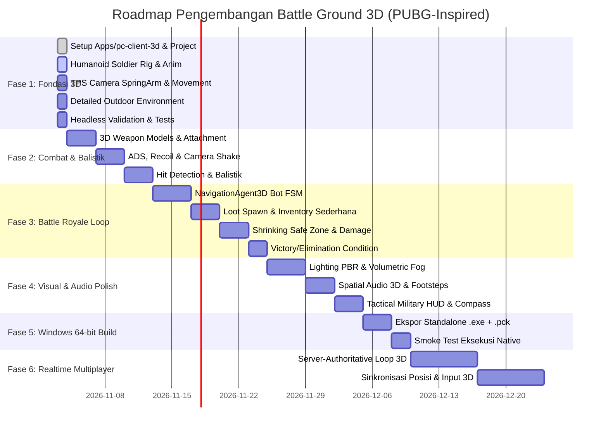

# Rencana Migrasi & Arsitektur Battle Ground 3D
## Transformasi Menuju Realistic 3D Military Tactical Third-Person Shooter (PUBG-Inspired)

Dokumen ini mendokumentasikan perencanaan strategis, audit komponen eksisting, arsitektur teknis 3D, pipeline aset berlisensi, dan roadmap implementasi untuk mentransformasi Battle Ground menjadi game PC Third-Person Shooter (TPS) 3D bergaya taktis militer menggunakan Godot Engine 4.x dan GDScript.

---

## 1. Ringkasan Eksekutif & Arah Baru Proyek

Battle Ground bertransformasi dari prototipe 2D top-down arcade menjadi **game PC 3D Third-Person Shooter (TPS) taktis realistis** yang terinspirasi oleh mekanika dan presentasi *PlayerUnknown's Battlegrounds* (PUBG).

### Spesifikasi Target:
- **Platform**: PC Only (Windows 64-bit native desktop; dapat diekspor ke Linux 64-bit).
- **Game Engine**: Godot Engine 4.x (terverifikasi: Godot 4.7.2 Stable Win64).
- **Bahasa Game**: GDScript murni (tanpa C++ GDExtension yang mempersulit portabilitas).
- **Perspektif Kamera**: Third-Person Shooter (TPS) dengan *over-the-shoulder camera*, *free-look*, dan *Aim Down Sights* (ADS).
- **Lingkungan**: Outdoor 3D realistis (medan berbukit, jalanan, vegetasi pohon/semak, struktur militer kontainer dan bangunan taktis).
- **Karakter**: Model tentara humanoid 3D berkerangka tulang (*rigged Skeleton3D*), kulit bertekstur PBR, dan animasi gerak realistis (Idle, Walk, Run, Sprint, Aim, Jump, Crouch).
- **Gameplay Jangka Panjang**: Battle Royale (Looting, Zona Biru menyusut, eliminasi bot/pemain, safe zone, supply drops).

### Batasan Ketat (Strict Restrictions):
1. **Tidak menggunakan React Native** pada client 3D PC.
2. **Tidak mengembangkan versi mobile** untuk cabang 3D ini.
3. **Tidak menggunakan C++ atau Unreal Engine**; mempertahankan Godot 4 + GDScript.
4. **Tidak mempertahankan tampilan 2D top-down** sebagai gameplay utama.
5. **Tidak menggunakan bentuk primitif** (lingkaran/persegi/kapsul polos) sebagai model akhir karakter atau senjata.
6. **Tidak menggunakan aset berhak cipta milik PUBG** (seluruh aset menggunakan model CC0 / CC-BY berlisensi resmi terbuka dengan atribusi penuh).
7. **Mempertahankan direktori `apps/pc-client/` (2D) tetap utuh** sebagai arsip sampai prototype 3D di `apps/pc-client-3d/` lolos acceptance criteria.

---

## 2. Audit Repositori & Analisis Komponen Reusable

Berdasarkan audit komprehensif pada repositori:

```
battleground/
├── apps/
│   ├── mobile/            # [Arsip] React Native Expo (tidak disentuh)
│   ├── pc-client/         # [Arsip Aktif] Client 2D Top-Down Godot (dipertahankan utuh)
│   ├── pc-client-3d/      # [BARU] Proyek Godot 4 3D TPS Mandiri
│   └── server/            # Backend Express + TS (reusable untuk auth & match)
├── packages/
│   ├── shared/            # Modul logika & kontrak bersama (reusable)
│   ├── protocol/          # JSON Schema (reusable & diperluas ke vektor 3D {x,y,z})
│   └── game-data/         # Game balance senjata & karakter (reusable untuk stat 3D)
├── docs/                  # Dokumentasi teknis proyek
└── README.md
```

### 2.1. Komponen yang Dapat Digunakan Kembali (Reusable):
1. **Konfigurasi Senjata & Karakter (`packages/game-data/`)**:
   - Parameter `damage`, `fireRate`, `magazineSize`, `reloadTime`, `spread`, dan `bulletSpeed` dapat dipetakan langsung ke proyektil/hitscan balistik 3D senjata Assault Rifle, Pistol, dan Shotgun.
2. **Kontrak Protokol Jaringan (`packages/protocol/`)**:
   - Skema `damage-event`, `health-update`, `score-update`, dan `match-state` bersifat agnostik dimensi.
   - Skema `player-move` dan `shoot-event` diperluas dari koordinat 2D `{x, y}` menjadi vektor 3D `{x, y, z}`.
3. **Pola Desain Autoload Godot**:
   - Arsitektur singleton `SettingsManager` (Display, Audio, Mouse Sensitivity) dan `AudioManager` (Audio Bus, SFX) dapat diadaptasi ke proyek 3D.
4. **Backend Server (`apps/server/`)**:
   - Arsitektur Express health check dan API matchmaking siap dihubungkan saat fase multiplayer 3D dimulai.

### 2.2. Komponen yang Harus Dibuat Baru Khusus 3D:
1. **Karakter & Animasi**: Penggantian kalkulasi 2D `_draw()` dengan `CharacterBody3D`, `Skeleton3D`, `MeshInstance3D`, dan `AnimationTree` (State Machine pergerakan 8-arah).
2. **Kamera TPS**: Penggantian `Camera2D` dengan `SpringArm3D` + `Camera3D` dengan anti-clipping terrain dan interpolasi bahu dinamis.
3. **Fisika & Medan Dunia**: Penggantian `StaticBody2D` boundary 2D dengan `WorldEnvironment` 3D, terrain mesh berkontur, pencahayaan matahari `DirectionalLight3D`, bayangan lembut, dan kabut atmosferik.
4. **Combat & Balistik**: RayCast3D hitscan / rigid proyektil balistik 3D dengan tracer proyektil, muzzle flash partikel 3D, dan dekal lubang peluru pada permukaan.

---

## 3. Desain Arsitektur Client 3D (`apps/pc-client-3d/`)

### 3.1. Struktur Folder
```
apps/pc-client-3d/
├── project.godot               # Konfigurasi Godot 4.x 3D (Forward+ / GL Compatibility)
├── export_presets.cfg          # Preset ekspor Windows 64-bit Desktop
├── assets/
│   ├── characters/soldier/     # Model rigged soldier GLB, tekstur PBR, animasi
│   ├── weapons/                # Model 3D senjata (Rifle, Pistol, Shotgun)
│   ├── environment/            # Mesh medan, kontainer militer, pohon, batu, jalan
│   ├── audio/                  # SFX langkah kaki 3D, tembakan, reload, desingan peluru
│   └── ui/                     # Reticle crosshair taktis, kompas 360°, ikon HUD
├── scenes/
│   ├── main/main_3d.tscn       # Scene utama orkestrasi game 3D
│   ├── player/soldier.tscn     # CharacterBody3D pemain + SpringArm3D + TPS Camera
│   ├── environment/map.tscn    # Peta outdoor perbukitan militer dengan kontainer
│   ├── weapons/                # Scene 3D senjata dengan muzzle marker & sockets
│   ├── enemies/                # Bot AI 3D dengan NavigationAgent3D
│   └── ui/hud_3d.tscn          # HUD taktis militer (HP, Kompas, Amunisi, Safe Zone)
├── scripts/
│   ├── player/                 # Controller karakter 3D, camera spring arm, ADS
│   ├── combat/                 # Balistik 3D, RayCast hitscan, recoil pattern
│   ├── environment/            # Logika safe zone lingkaran menyusut (Battle Royale)
│   ├── ai/                     # FSM Bot 3D (Patrol, Search, Loot, Attack, Cover)
│   └── systems/                # Game data loader, settings, audio manager 3D
└── tests/
    └── test_3d_smoke.gd        # Uji headless integritas scene dan gerak 3D
```

### 3.2. Arsitektur Kamera TPS & Kontrol Karakter
- **SpringArm3D**: Panjang lengan 3.0m, offset bahu kanan (X: 0.6m, Y: 0.2m) untuk over-the-shoulder view. Dilengkapi sphere collision shape (radius 0.2m) agar kamera tidak menembus dinding atau pohon.
- **Pivoting & Pitch Clamping**:
  - Yaw (rotasi horizontal): 360° bebas mengikuti mouse X.
  - Pitch (rotasi vertikal): Dibatasi antara -70° (melihat ke bawah) dan +60° (melihat ke atas).
- **Movement Physics**:
  - Pergerakan kamera-relatif: Tombol `W` selalu menggerakkan karakter ke arah hadap kamera horizontal.
  - Akselerasi (lerp pergerakan 12.0) dan deselerasi mulus saat berhenti.
  - Kecepatan: Jalan (4.5 m/s), Sprint (8.0 m/s), Crouch (2.5 m/s).
  - Rotasi tubuh: Karakter berputar mulus menghadap arah lari saat eksplorasi, dan menghadap lurus ke titik bidik saat menembak atau membidik (ADS).

---

## 4. Pipeline Aset & Kepatuhan Lisensi

Seluruh aset 3D yang digunakan diverifikasi secara ketat agar bebas dari pelanggaran hak cipta:
1. **Model Karakter Tentara Humanoid**:
   - Menggunakan model resmi Godot TPS Soldier / Operator Combat berkerangka tulang lengkap (*fully rigged Skeleton3D* dengan 80+ tulang biped) berlisensi **Creative Commons Attribution 3.0 (CC-BY 3.0)** dan **MIT License** karya Juan Linietsky & Fernando Miguel Calabró.
2. **Model Senjata & Properti Taktis**:
   - Menggunakan aset model GLB militer berlisensi **CC0 1.0 Universal (Public Domain)** dari repositori Quaternius / Kenney.
3. **Tekstur PBR Lingkungan**:
   - Albedo, Normal, Roughness, dan Ambient Occlusion berlisensi CC0 dari ambientCG / Poly Haven untuk material tanah, rumput, jalan aspal, dan logam kontainer militer.
4. **Dokumentasi Atribusi**:
   - Seluruh lisensi dan kredit penulis dicantumkan secara eksplisit dalam `apps/pc-client-3d/CREDITS.md` dan `LICENSE.md`.

---

## 5. Roadmap 6 Fase Pengembangan Battle Ground 3D



---

## 6. Kriteria Penerimaan Fase 1 (Acceptance Criteria)

Untuk menyatakan Fase 1 selesai, deliverable harus membuktikan secara nyata:
- [ ] Folder proyek baru `apps/pc-client-3d/` terkonfigurasi mandiri tanpa merusak `apps/pc-client/`.
- [ ] Model tentara humanoid 3D berkerangka tulang asli (`Skeleton3D` + skinning mesh) berhasil dimuat.
- [ ] Minimal 1 animasi gerak (Idle / Walk / Run) berfungsi pada karakter tentara.
- [ ] Sistem kamera Third-Person (`SpringArm3D` + `Camera3D`) mengikuti pemain secara mulus tanpa menembus dinding.
- [ ] Kontrol pergerakan kamera-relatif: `W`, `A`, `S`, `D` bergerak mulus, `Shift` untuk sprint, `Spasi` untuk melompat dengan gravitasi 3D.
- [ ] Kursor mouse mengendalikan rotasi pandangan kamera 360° (pitch & yaw dibatasi halus).
- [ ] Lingkungan outdoor 3D dengan medan bertekstur, pencahayaan matahari `DirectionalLight3D`, bayangan realistis, kabut atmosferik, dan rintangan fisik kontainer militer bertabrakan aktif (`StaticBody3D`).
- [ ] Uji smoke test headless Godot 4.x berhasil dieksekusi dengan hasil lolos (PASS).

