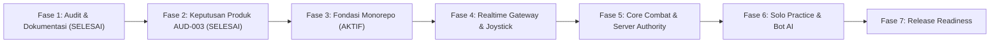

# Rencana Implementasi

Status: Diperbarui & Berjalan (2026-10-29).

## Ringkasan Tahapan Proyek

---

## Detail Tahapan

### Fase 1 — Audit Repository & Governance Baseline (SELESAI)
- Memverifikasi status greenfield repository berbasis bukti.
- Mengidentifikasi ketiadaan manifest dan kode pengguna terdahulu.
- Terdokumentasi pada `docs/AUDIT_REPORT.md`.

### Fase 2 — Keputusan Produk & Desain Game (SELESAI)
- Konfirmasi genre: **Top-Down Arena Shooter 2D**.
- Konfirmasi kontrol: **Dual Virtual Joystick** (Kiri: Translasi arah/kecepatan, Kanan: Aiming/Bidikan dan Tembakan).
- Konfirmasi mode: **Realtime Synchronous Multiplayer** dan **Solo Practice**.
- Konfirmasi arsitektur state: **Server-Authoritative** (state, damage, eliminasi, skor).
- Konfirmasi transport: **REST API** dan **Socket.IO**.
- Status temuan **AUD-003**: RESOLVED.

### Fase 3 — Fondasi Monorepo & Integrasi Health Connectivity (AKTIF)
- Setup npm workspaces: `apps/mobile`, `apps/server`, `packages/shared`.
- Setup kontrak bersama `@battleground/shared` (`HealthStatusResponse`).
- Setup Express backend: `/api/v1/health`, helmet, cors, error handling terpusat, graceful shutdown.
- Setup Mobile Expo: Layar inisial interaktif dengan konektivitas backend, retry, dan feedback state visual.
- Pengujian: Typecheck monorepo, unit/integration test backend dengan Jest & Supertest.

### Fase 4 — Realtime Room Gateway & Mobile Dual Joystick (Tahap Berikutnya)
- Mengintegrasikan Socket.IO pada `apps/server`.
- Implementasi komponen Dual Virtual Joystick di `apps/mobile`.
- Protokol pengiriman input vektor pergerakan dari mobile ke server (20-30 Hz).

### Fase 5 — Server-Authoritative Combat Engine (Tahap Berikutnya)
- Bounding-box arena dan kalkulasi pergerakan karakter di server.
- Mekanika tembakan proyektil, hit detection, pengurangan HP, dan eliminasi pemain.
- Sinkronisasi snapshot state ke seluruh klien.

### Fase 6 — Solo Practice Mode & Bot AI (Tahap Berikutnya)
- Implementasi arena mandiri untuk uji coba kontrol dan latihan tanpa lawan manusia.

### Fase 7 — Persistence, Polish & Release Readiness (Tahap Berikutnya)
- Setup database (SQLite/PostgreSQL) untuk profil pemain dan leaderboard.
- Verifikasi bundle release Expo dan production build server.
