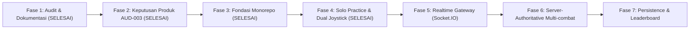

# Rencana Implementasi

Status: Diperbarui & Berjalan (2026-10-29).

## Ringkasan Tahapan Proyek

---

## Detail Tahapan

### Fase 1 — Audit Repository & Governance Baseline (SELESAI)
- Memverifikasi status greenfield repository berbasis bukti.
- Mengidentifikasi ketiadaan manifest dan kode pengguna terdahulu.

### Fase 2 — Keputusan Produk & Desain Game (SELESAI)
- Konfirmasi genre: **Top-Down Arena Shooter 2D**.
- Konfirmasi kontrol: **Dual Virtual Joystick**.
- Konfirmasi mode: **Realtime Synchronous Multiplayer** dan **Solo Practice**.
- Konfirmasi arsitektur state: **Server-Authoritative**.

### Fase 3 — Fondasi Monorepo & Integrasi Health Connectivity (SELESAI)
- Setup npm workspaces: `apps/mobile`, `apps/server`, `packages/shared`.
- Express backend: `/api/v1/health`, helmet, cors, error handling terpusat, graceful shutdown.
- Mobile Expo: Layar monitor konektivitas dengan penanganan retry dan timeout.
- Setup tooling ESLint monorepo & perbaikan dependensi Expo (18/18 checks passed).

### Fase 4 — Vertical Slice Solo Practice & Dual Joystick 2D (SELESAI)
- Modul fisika matematika di `@battleground/shared` (collision detection, clamp arena, unit vectors).
- Komponen `VirtualJoystick` berbasis React Native `PanResponder`.
- Komponen `SoloPracticeArena`: Game loop 60 FPS, karakter pemain, tembakan peluru berkecepatan tinggi, target dummy bot, collision & deduksi HP, eliminasi skor, Game Over state, dan tombol reset instan.
- Pengujian unit test fisika (10/10 passed).

### Fase 5 — Realtime Gateway Socket.IO (Tahap Berikutnya)
- Mengintegrasikan `socket.io` pada HTTP server Express.
- Setup room management (`join_room`, `leave_room`, `disconnect`).
- Pemetaan transport snapshot 20–30 Hz.

### Fase 6 — Server-Authoritative Multiplayer Combat (Tahap Berikutnya)
- Memindahkan komputasi collision peluru-pemain dan boundary arena ke server authoritative.
- Client prediction dan interpolasi gerak visual pemain lain di layar Expo.

### Fase 7 — Persistence, Profil Pemain & Leaderboard (Tahap Berikutnya)
- Database schema untuk menyimpan riwayat match dan skor pemain.
