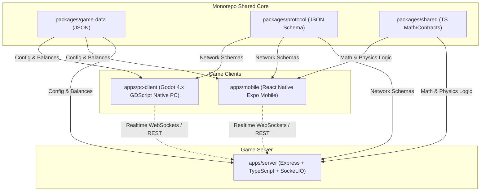

# Arsitektur Battle Ground PC (Godot 4.x)

Dokumen ini mendefinisikan arsitektur teknis client PC native untuk Battle Ground menggunakan Godot Engine 4.x, serta hubungannya dengan Express backend, React Native mobile client, dan monorepo shared packages.

## 1. Ringkasan Sistem & Topologi

Battle Ground dikembangkan dengan arsitektur multi-client berbasis monorepo:



## 2. Struktur Client PC (`apps/pc-client`)

Project Godot 4.x diorganisir secara modular berdasarkan domain tanggung jawab:

- `project.godot`: Konfigurasi engine (viewport 1280x720, GL Compatibility renderer, autoloads, input action bindings).
- `scenes/`: Scene deklaratif Godot (`.tscn`).
  - `main/main.tscn`: Root orchestrator yang mengatur transisi scene.
  - `menu/main_menu.tscn`: Menu utama (Solo Practice, Multiplayer Phase 2, Settings, Quit).
  - `menu/settings_menu.tscn`: Dialog pengaturan (display mode, volume bus, mouse sensitivity).
  - `arena/arena.tscn`: Arena pertempuran playable dengan boundary collision dan target practice.
  - `player/player.tscn`: Karakter pemain (`CharacterBody2D`) dengan camera smoothing dan weapon mount.
  - `ui/hud.tscn`: Telemetri tempur (HP bar, ammo clip, weapon name, match timer, score).
  - `ui/pause_menu.tscn`: Pause overlay in-game (`process_mode = ALWAYS`).
  - `combat/projectile.tscn`: Peluru proyektil (`Area2D`) dengan deteksi tabrakan.
- `scripts/`: Kode GDScript (`.gd`) logika gameplay, fisika, combat, dan sistem.
  - `gameplay/`: `player.gd`, `game_manager.gd`, `main_menu.gd`, `main_root.gd`, `hud.gd`, `settings_menu.gd`, `pause_menu.gd`.
  - `combat/`: `weapon.gd`, `health.gd`, `projectile.gd`.
  - `physics/`: `arena_bounds.gd`.
  - `ai/`: `target_dummy.gd`.
  - `systems/`: `game_data_loader.gd`, `settings_manager.gd`, `audio_manager.gd`.
- `resources/data/`: Salinan lokal aset data JSON (`character.json`, `weapons.json`, `arena.json`) yang disinkronkan dari `packages/game-data/`.
- `tests/`: Skrip uji otomatis tanpa jendela GUI (`test_headless_smoke.gd`).
- `export_presets.cfg`: Konfigurasi build executable native Windows Desktop x86_64.

## 3. Autoload Singletons

Tiga autoload singleton dikonfigurasi di `project.godot` untuk manajemen state global:

1. `GameDataLoader` (`scripts/systems/game_data_loader.gd`):
   - Bertanggung jawab membaca file JSON dari `res://resources/data/`.
   - Menyediakan interface terpusat (`get_character_data()`, `get_weapons_data()`, `get_arena_data()`, `get_weapon(id)`).
   - Memiliki fallback data bawaan untuk menjamin stabilitas jika file eksternal tidak ditemukan.

2. `SettingsManager` (`scripts/systems/settings_manager.gd`):
   - Mengelola preferensi pengguna: Fullscreen, V-Sync, Master/Music/SFX volume, dan sensitivitas mouse.
   - Menyimpan konfigurasi ke file disk `user://settings.cfg`.
   - Mengaplikasikan perubahan audio ke `AudioServer` bus dan mode tampilan ke `DisplayServer`.

3. `AudioManager` (`scripts/systems/audio_manager.gd`):
   - Pool player audio (`AudioStreamPlayer`) untuk efek suara tembakan, hit, reload, dan dash.
   - Dilengkapi generator audio prosedural (`AudioStreamGenerator`) sebagai fallback sintetis jika aset `.wav`/`.ogg` belum diimpor ke project.

## 4. Hirarki Node Arena & Siklus Hidup

```
Arena (GameManager)
├── ArenaBounds (StaticBody2D dinding & obstacle)
├── TargetsContainer (Wadah TargetDummy)
│   ├── TargetDummy (CharacterBody2D + Health)
│   └── ...
├── Player (CharacterBody2D)
│   ├── CollisionShape2D (radius 16px)
│   ├── Camera2D (smooth follow speed 8.0)
│   ├── MuzzleMarker (Marker2D offset 26px)
│   ├── Health (Component max 100)
│   └── Weapon (Component fire rate, clip, reload)
├── HUD (CanvasLayer telemetri tempur)
└── PauseMenu (CanvasLayer in-game overlay)
```

## 5. Sinkronisasi Data & Game Balance Antar Platform

Untuk menjaga kesetaraan gameplay (game balance parity) antara versi PC dan Mobile:

- Radius Player: 16 pixel (`CharacterBody2D` CircleShape).
- Radius Bullet: 4 pixel (`Area2D` CircleShape).
- Dimensi Arena Default: 1600 x 1200 pixel.
- Kecepatan Bergerak Dasar: 300 px/s (Sprint: 450 px/s, Dash: 700 px/s).
- Senjata:
  - Pistol: Damage 20, Clip 12, Fire Rate 3.0/s, Reload 1.2s.
  - Shotgun: Damage 12 per butir (6 pellet), Clip 6, Fire Rate 1.2/s, Reload 2.0s.
  - Rifle: Damage 15, Clip 30, Fire Rate 8.0/s, Reload 1.8s.

## 6. Target Performa & Kompatibilitas

- Target Frame Rate: 60 FPS (baseline) hingga 144+ FPS pada monitor high refresh rate.
- Frame Time Budget: < 16.6 ms (pada 60 Hz) / < 6.94 ms (pada 144 Hz).
- Rendering Method: `gl_compatibility` (OpenGL 3.3 / ES 3.0), menjamin kompatibilitas optimal di Windows 10/11 baik pada GPU dedicated maupun integrated graphics (Intel UHD / Iris Xe / AMD Radeon Vega).
- Memory Footprint: Target < 150 MB RAM untuk mode offline solo practice.

