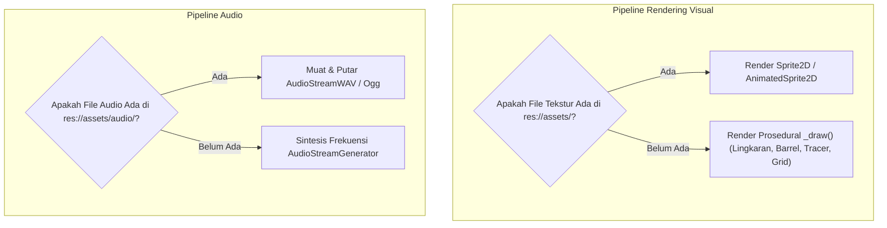

# Pipeline Aset Battle Ground PC

Dokumen ini mendokumentasikan organisasi aset visual, audio, data konfigurasi, serta panduan konversi aset dari mobile ke client PC native.

## 1. Struktur Direktori Aset (`apps/pc-client/assets`)

```
apps/pc-client/assets/
├── audio/          # Efek suara (.wav) dan musik latar (.ogg)
├── characters/     # Sprite / tekstur operator karakter (.png, .svg)
├── effects/        # Partikel moncong senjata, asap, percikan darah (.png)
├── environment/    # Tekstur lantai arena, dinding bata, peti rintangan
├── ui/             # Ikon senjata, crosshair kursor kustom, font (.ttf, .otf)
└── weapons/        # Sprite senjata genggam dan item pick-up
```

## 2. Strategi Dual-Pipeline: Prosedural & Tekstur

Untuk menjamin client PC dapat dimainkan secara fungsional tanpa ketergantungan file eksternal yang besar, project mengadopsi pendekatan Dual-Pipeline:



### 2.1. Rendering Prosedural (Fase 1 Foundation)
- Karakter Pemain: Digambar melalui kalkulasi geometris instan (`draw_circle`, `draw_rect`) menghasilkan visual top-down operative dengan helm/visor bercahaya dan laras senjata hitam matte.
- Peluru Proyektil: Garis tracer oranye-kuning dinamis dengan kepala proyektil bulat.
- Dinding & Rintangan: Garis grid cyber-arena dengan blok rintangan metalik berbingkai cyan.
- Keunggulan: Skalabilitas resolusi murni tanpa blur atau artefak piksel dari 720p hingga 4K UHD.

### 2.2. Aset Produksi (Fase 2+)
- Format Gambar Rekomendasi: PNG RGBA (32-bit tanpa kompresi lossy) atau SVG untuk antarmuka UI resolusi tinggi.
- Standar Resolusi Sprite:
  - Karakter: 64x64 atau 128x128 pixel.
  - Senjata: 32x64 pixel.
  - Proyektil: 16x16 pixel atau partikel sistem.
- Texture Filtering: Linear dengan Mipmaps untuk visual modern, atau Nearest-neighbor jika mode retro piksel dipilih.

## 3. Pipeline Audio & Sound Effects

1. Format Efek Suara (SFX):
   - Format: WAV (16-bit PCM, 44.1 kHz atau 48 kHz).
   - Penggunaan: Tembakan, ledakan, benturan proyektil, langkah kaki, klik reload.
   - Karakteristik: Tanpa latensi dekompresi, responsif saat penembakan intensitas tinggi.

2. Format Musik Latar (BGM):
   - Format: OGG Vorbis (Q6 - Q8).
   - Karakteristik: Kompresi ukuran file kecil dengan kualitas looping musik arena yang mulus.

3. Generator Sintesis Fallback:
   - Terintegrasi dalam `AudioManager` menggunakan `AudioStreamGenerator`.
   - Mengeluarkan gelombang sinus harmonis singkat dengan modulasi nada (880 Hz untuk tembakan, 320 Hz untuk benturan hit, 550 Hz untuk reload).

## 4. Pipeline Data Konfigurasi Permainan

1. Sumber Kebenaran (Single Source of Truth):
   - `packages/game-data/*.json` di root monorepo.
2. Mekanisme Sinkronisasi:
   - File JSON disalin ke `apps/pc-client/resources/data/`.
   - Client membaca file pada saat startup menggunakan `FileAccess` dan parser `JSON` bawaan engine.
3. Fallback Built-in:
   - Jika file JSON terhapus atau rusak, `GameDataLoader` menggunakan data hardcoded bawaan sehingga engine tidak akan pernah mengalami crash fatal.

