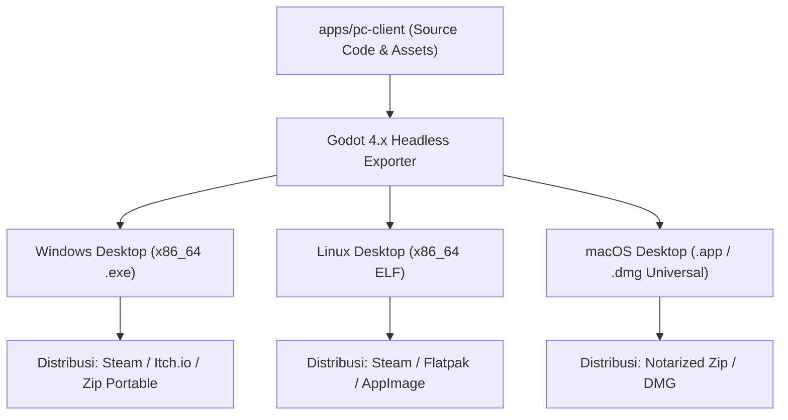

# Panduan Build & Deployment Battle Ground PC

Dokumen ini menjelaskan prosedur kompilasi, ekspor biner native, validasi headless, dan pipeline distribusi untuk client PC Battle Ground.

## 1. Prasyarat Sistem

- Godot Engine: Versi 4.3 atau yang lebih baru (terverifikasi: Godot 4.7.2 Stable Win64).
- Sistem Operasi Host Pengembangan: Windows 10/11 x64 (didukung Linux dan macOS via toolchain terkait).
- Lokasi Binary Godot Lokal:
  `C:\Users\GAMING DEVICES\AppData\Local\Microsoft\WinGet\Packages\GodotEngine.GodotEngine_Microsoft.Winget.Source_8wekyb3d8bbwe\Godot_v4.7.2-stable_win64_console.exe`

## 2. Validasi Kualitas Tanpa GUI (Headless Checks)

Sebelum melakukan kompilasi rilis, integritas skrip GDScript dan scene `.tscn` dapat divalidasi melalui CLI:

### 2.1. Validasi Sintaks Skrip & Scene
```powershell
$GODOT_BIN = "C:\Users\GAMING DEVICES\AppData\Local\Microsoft\WinGet\Packages\GodotEngine.GodotEngine_Microsoft.Winget.Source_8wekyb3d8bbwe\Godot_v4.7.2-stable_win64_console.exe"

& $GODOT_BIN --headless --path apps/pc-client --check-only
```

### 2.2. Eksekusi Skrip Uji Smoke Test
```powershell
& $GODOT_BIN --headless --path apps/pc-client -s tests/test_headless_smoke.gd
```
Uji ini memverifikasi:
1. `GameDataLoader` memuat data karakter, senjata, dan arena tanpa galat.
2. Scene `Main` dan `MainMenu` dapat diinstansiasi secara bersih.
3. Scene `Arena`, karakter `Player`, komponen `Health`, dan `Weapon` siap beroperasi.
4. Komponen `Health` mengeksekusi perhitungan damage secara akurat.

## 3. Konfigurasi Export Preset (`export_presets.cfg`)

File konfigurasi ekspor terletak di `apps/pc-client/export_presets.cfg`. Konfigurasi awal menyediakan preset untuk Windows Desktop:

- Platform: Windows Desktop
- Format Biner: x86_64 (Embedded PCK = true)
- Kompresi Tekstur: BPTC + S3TC
- Output File: `builds/windows/battle_ground.exe`

## 4. Perintah Kompilasi / Ekspor Biner Native

Untuk mengekspor biner native mandiri dari baris perintah:

```powershell
# Buat direktori tujuan build
New-Item -ItemType Directory -Path "builds/windows" -Force

# Ekspor biner rilis
& $GODOT_BIN --headless --path apps/pc-client --export-release "Windows Desktop" builds/windows/battle_ground.exe
```

*Catatan: Ekspor rilis membutuhkan template ekspor resmi Godot (`export_templates`) yang dapat diunduh melalui editor Godot atau repository unduhan resmi.*

## 5. Rencana Distribusi Multi-Platform



