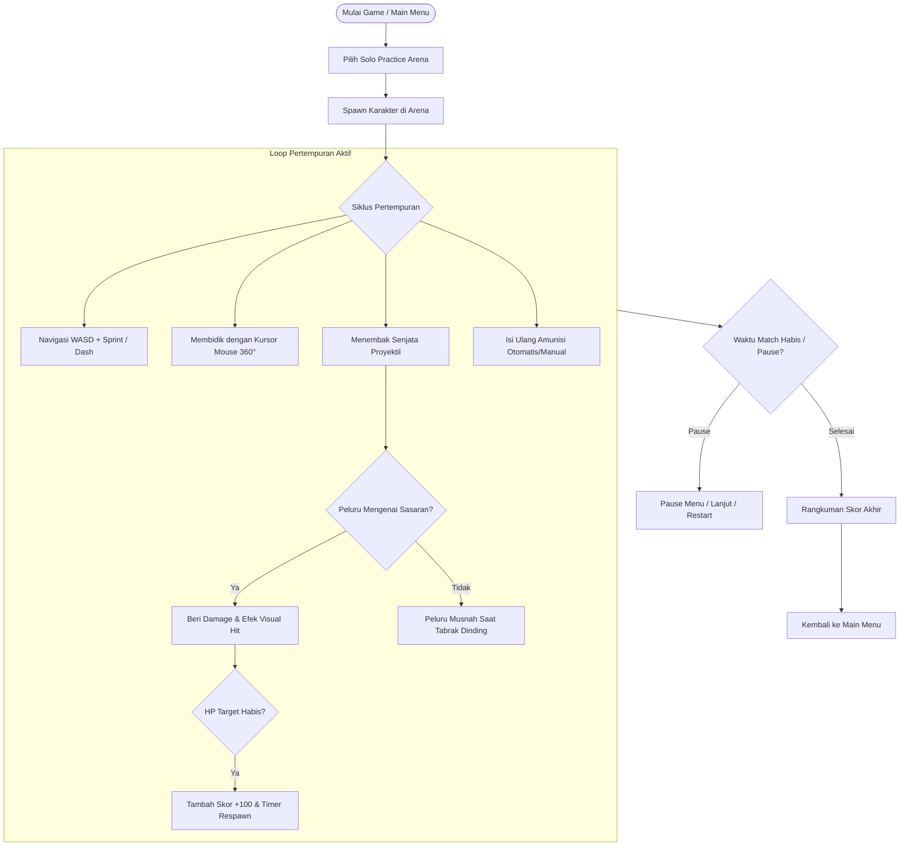

# Desain Gameplay & Mekanika Battle Ground PC

Dokumen ini mendokumentasikan spesifikasi mekanika permainan, sistem pertempuran, penanganan karakter, dan loop gameplay untuk client PC Battle Ground.

## 1. Identitas Game

- Genre: 2D Top-Down Tactical Arena Shooter.
- Perspektif: Kamera tegak lurus dari atas (bird's-eye view) mengikuti posisi pemain dengan interpolasi pergerakan halus (`position_smoothing`).
- Platform: Windows Desktop Native (dapat diperluas ke Linux dan macOS).

## 2. Inti Siklus Permainan (Core Game Loop)

## 3. Kontrol dan Pergerakan Karakter

Pemain mengendalikan operator taktis menggunakan kombinasi keyboard dan mouse standar PC:

| Aksi | Tombol Default | Perilaku & Nilai Parameter |
| :--- | :--- | :--- |
| Bergerak Atas | `W` / Panah Atas | Vektor Y negatif (-1.0) |
| Bergerak Kiri | `A` / Panah Kiri | Vektor X negatif (-1.0) |
| Bergerak Bawah | `S` / Panah Bawah | Vektor Y positif (+1.0) |
| Bergerak Kanan | `D` / Panah Kanan | Vektor X positif (+1.0) |
| Sprint | `Shift Kiri` | Meningkatkan kecepatan dari 300 px/s menjadi 450 px/s |
| Dash | `Spasi` | Burst kecepatan 700 px/s selama 0.15 detik (Cooldown: 1.0 detik) |
| Bidik (Aim) | `Mouse Cursor` | Rotasi karakter 360 derajat mengarah ke posisi pointer mouse |
| Tembak | `Klik Kiri (LMB)` | Melepaskan tembakan sesuai fire rate senjata aktif |
| Isi Ulang (Reload) | `R` | Memulai siklus reload magazine senjata |
| Senjata 1 | `1` | Memilih Standard Pistol |
| Senjata 2 | `2` | Memilih Pump Shotgun |
| Senjata 3 | `3` | Memilih Assault Rifle |
| Pause / Menu | `ESC` | Menghentikan sementara game tree dan menampilkan Pause Menu |

## 4. Sistem Persenjataan & Balistik

Client PC mengadopsi sistem persenjataan berbasis proyektil (`Area2D`) dengan karakteristik yang terikat ke `packages/game-data/weapons.json`:

### 4.1. Standard Pistol
- Archetype: Semi-otomatis, akurasi tinggi, proyektil cepat.
- Damage: 20 per tembakan.
- Fire Rate: 3.0 tembakan / detik.
- Kapasitas Magazine: 12 butir.
- Waktu Reload: 1.2 detik.
- Kecepatan Proyektil: 800 px/s.
- Jarak Tempuh Maksimum: 600 px.
- Spread: 2.0 derajat.

### 4.2. Pump Shotgun
- Archetype: Tembakan menyebar (buckshot spread), daya hancur jarak dekat.
- Damage: 12 per pellet (total 6 pellet = potensi damage 72).
- Fire Rate: 1.2 tembakan / detik.
- Kapasitas Magazine: 6 butir.
- Waktu Reload: 2.0 detik.
- Kecepatan Proyektil: 700 px/s.
- Jarak Tempuh Maksimum: 400 px.
- Spread: 12.0 derajat.

### 4.3. Assault Rifle
- Archetype: Otomatis beruntun, tekanan tembakan kontinu.
- Damage: 15 per tembakan.
- Fire Rate: 8.0 tembakan / detik.
- Kapasitas Magazine: 30 butir.
- Waktu Reload: 1.8 detik.
- Kecepatan Proyektil: 950 px/s.
- Jarak Tempuh Maksimum: 800 px.
- Spread: 4.5 derajat.

## 5. Sistem Health, Damage, & Dummy Latihan

1. `Health` Component:
   - Dikelola oleh script terpisah (`res://scripts/combat/health.gd`).
   - Menyediakan sinyal `health_changed`, `damaged`, `healed`, dan `died`.
   - Mengontrol batasan nilai HP antara `0` dan `max_health`.

2. Target Dummy Latihan:
   - Ditempatkan di berbagai sudut strategis arena (6 titik spawn).
   - Memiliki HP maksimal 60 (hancur dalam 3 tembakan pistol).
   - Memberikan feedback visual kedipan (damage flash) saat terkena peluru.
   - Mengeluarkan suara benturan peluru (`AudioManager.play_sfx("hit")`).
   - Otomatis hidup kembali (respawn) 3 detik setelah hancur untuk latihan berkelanjutan.

3. Kematian Pemain:
   - Jika HP pemain mencapai 0, karakter memasuki kondisi nonaktif.
   - Dalam mode Solo Practice, pemain otomatis respawn di titik pusat arena setelah 2 detik dengan HP penuh.

