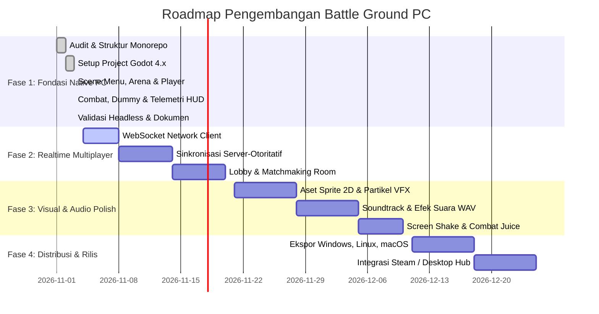

# Rencana Implementasi & Roadmap Battle Ground PC

Dokumen ini memetakan tahapan evolusi transformasi Battle Ground dari aplikasi mobile awal menjadi game PC native 2D tactical arena shooter.

## 1. Ikhtisar Tahapan (Roadmap Overview)

## 2. Rincian Pekerjaan Setiap Fase

### Fase 1: Fondasi Offline Playable PC (STATUS: SELESAI / COMPLETED)
- [x] Audit komprehensif monorepo, backend, mobile client, dan shared packages (`docs/PC_MIGRATION_AUDIT.md`).
- [x] Standardisasi package data agnostik: `packages/game-data` (JSON) dan `packages/protocol` (JSON Schema).
- [x] Inisialisasi project Godot 4.7.2 (`apps/pc-client/project.godot`) dengan renderer GL Compatibility.
- [x] Konfigurasi Input Map untuk kontrol PC (WASD, Mouse Aim 360°, Space Dash, Shift Sprint, 1-3 Weapon Switch, ESC Pause).
- [x] Implementasi autoload: `GameDataLoader`, `SettingsManager`, `AudioManager`.
- [x] Scene `Player` (`CharacterBody2D`) dengan pergerakan, dash, rotasi mouse, dan kamera halus (`Camera2D`).
- [x] Sistem senjata: Pistol, Shotgun, Assault Rifle dengan reload otomatis dan manual.
- [x] Dinding pembatas arena (`StaticBody2D`) dan rintangan balok taktis (`arena_bounds.gd`).
- [x] Target dummy latihan dengan deteksi tabrakan proyektil dan respawn berkala.
- [x] Antarmuka HUD telemetri tempur: HP Bar, Ammo Clip, Nama Senjata, Timer 5 menit, dan Skor eliminasi.
- [x] Pause Menu overlay (`process_mode = ALWAYS`) untuk Resume, Restart, dan Keluar.
- [x] Main Menu dengan judul, opsi Play Solo Practice, Settings dialog, dan Quit.
- [x] Skrip uji headless smoke test (`apps/pc-client/tests/test_headless_smoke.gd`) terverifikasi 4/4 PASS.

### Fase 2: Realtime Multiplayer & Integrasi Server
- [ ] Implementasi modul `network_client.gd` berbasis `WebSocketPeer` di `apps/pc-client/scripts/networking/`.
- [ ] Endpoint room dan WebSocket gateway di `apps/server/src/`.
- [ ] Implementasi loop simulasi game di server (server-authoritative game loop 30 Hz).
- [ ] Sinkronisasi state via `player-input.schema.json` dan `game-state.schema.json`.
- [ ] Rekonsiliasi prediksi klien untuk meminimalkan persepsi latensi.
- [ ] Antarmuka lobby room untuk join match via kode room atau quick match.

### Fase 3: Visual Polish & Asset Pipeline
- [ ] Penggantian rendering prosedural dengan sheet sprite profesional (karakter militer/cyber, senjata kustom).
- [ ] Efek partikel moncong senjata (muzzle flash), asap reload, dan percikan benturan peluru (sparks).
- [ ] Efek feedback pertempuran: Dynamic screen shake saat menembakkan shotgun atau menerima damage.
- [ ] Impor file audio berkualitas tinggi (.wav untuk SFX, .ogg untuk musik ambient arena tegang).
- [ ] Desain font bitmap/vektor kustom untuk HUD arcade modern.

### Fase 4: Build, Optimasi & Rilis Multi-Platform
- [ ] Ekspor biner Windows Desktop (`.exe` mandiri dengan ikon dan metadata versi).
- [ ] Ekspor dan pengujian native Linux (Ubuntu/Debian x86_64).
- [ ] Ekspor dan pengujian native macOS (Universal binary ARM64/x86_64).
- [ ] Integrasi antarmuka pemetaan ulang tombol keyboard (key remapping UI) di Settings.
- [ ] Validasi keamanan & batas kecepatan paket jaringan untuk mencegah manipulasi kecepatan (speed-hack).

