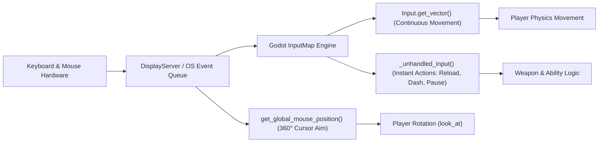

# Sistem Input & Kontrol Battle Ground PC

Dokumen ini menjelaskan arsitektur penanganan input pada client PC Battle Ground, konfigurasi Input Map, penanganan bidikan mouse, serta mekanisme kustomisasi binding.

## 1. Arsitektur Input Godot 4.x

Input pada Battle Ground PC memanfaatkan subsistem Input Map bawaan Godot yang dikombinasikan dengan pembacaan koordinat kursor mouse global untuk rotasi karakter.



## 2. Definisi Aksi Input (Input Map Actions)

Konfigurasi aksi terdaftar dalam `apps/pc-client/project.godot`:

| Action Name | Default Hardware Event | Physical Keycode / Button | Deadzone |
| :--- | :--- | :--- | :--- |
| `move_left` | Tombol `A` / `Panah Kiri` | `65` (A), `4194319` (Left) | 0.5 |
| `move_right` | Tombol `D` / `Panah Kanan` | `68` (D), `4194321` (Right) | 0.5 |
| `move_up` | Tombol `W` / `Panah Atas` | `87` (W), `4194320` (Up) | 0.5 |
| `move_down` | Tombol `S` / `Panah Bawah` | `83` (S), `4194322` (Down) | 0.5 |
| `fire` | Mouse Button 1 (Kiri) | `MOUSE_BUTTON_LEFT` (1) | 0.5 |
| `reload` | Tombol `R` | `82` (R) | 0.5 |
| `sprint` | Shift Kiri | `4194325` (Shift) | 0.5 |
| `dash` | Tombol Spasi | `32` (Space) | 0.5 |
| `pause` | Tombol Escape | `4194305` (Escape) | 0.5 |
| `weapon_1` | Angka `1` | `49` (1) | 0.5 |
| `weapon_2` | Angka `2` | `50` (2) | 0.5 |
| `weapon_3` | Angka `3` | `51` (3) | 0.5 |

## 3. Penanganan Bidikan Mouse (360° Mouse Aiming)

Rotasi karakter dihitung secara real-time pada setiap siklus `_physics_process`:

```gdscript
func _handle_aiming() -> void:
    var mouse_pos = get_global_mouse_position()
    var aim_dir = (mouse_pos - global_position).normalized()
    if aim_dir.length_squared() > 0.001:
        rotation = aim_dir.angle()
```

Karakteristik penting:
- Bebas sudut diskrit: Pemain dapat membidik secara presisi pada setiap fraksi derajat tanpa locking 8-arah.
- Sensitivitas Kursor: Dikelola melalui `SettingsManager.mouse_sensitivity` (rentang 0.1x hingga 3.0x).
- Independensi Pergerakan: Pemain dapat bergerak ke arah kiri (mundur) sembari membidik dan menembak ke arah kanan (strafing / kiting taktis).

## 4. Mekanisme Kustomisasi Binding (Rebinding Support)

Meskipun konfigurasi default telah disiapkan di `project.godot`, arsitektur engine memungkinkan kustomisasi tombol oleh pemain:

1. Pembacaan Konfigurasi Pengguna:
   - File `user://settings.cfg` dapat menyimpan `input_bindings` khusus.
2. Modifikasi InputMap secara Dinamis:
   ```gdscript
   func rebind_action(action_name: String, new_event: InputEvent) -> void:
       InputMap.action_erase_events(action_name)
       InputMap.action_add_event(action_name, new_event)
   ```
3. Penyimpanan Permanen:
   - Tersimpan bersama preferensi display dan audio pengguna.

