# Rencana Arsitektur Multiplayer Battle Ground PC (Fase 2)

Dokumen ini menguraikan arsitektur jaringan, evaluasi transport protokol, model sinkronisasi server-otoritatif, dan kesiapan cross-play antara PC client dan Express backend.

## 1. Arsitektur Jaringan Server-Otoritatif

Untuk menjaga integritas kompetitif dan mencegah cheat (seperti teleportasi posisi, tembus dinding, atau injeksi damage):

```mermaid
sequenceDiagram
    autonumber
    actor PC as PC Client (Godot 4.x)
    participant Srv as Express + Socket.IO Server
    actor Mob as Mobile Client (Expo)

    Note over PC,Mob: Fase Matchmaking & Koneksi Room
    PC->>Srv: Connect WebSocket & Join Room
    Mob->>Srv: Connect WebSocket & Join Room
    Srv-->>PC: Match Started (Arena Config & Initial State)
    Srv-->>Mob: Match Started (Arena Config & Initial State)

    Note over PC,Mob: Game Loop Realtime (Tick Rate 30-60 Hz)
    loop Setiap Client Tick
        PC->>Srv: Kirim Input Packet (WASD vector, Aim angle, Fire flag)
        Mob->>Srv: Kirim Input Packet (Virtual Joystick vector, Fire flag)
    end

    Note over Srv: Server Simulasi Fisika & Validasi
    rect rgb(20, 30, 45)
        Srv->>Srv: 1. Batasi kecepatan (clamp speed <= max_speed)
        Srv->>Srv: 2. Validasi cooldown tembakan (fire rate limiter)
        Srv->>Srv: 3. Deteksi tabrakan peluru (server-side circle collision)
        Srv->>Srv: 4. Hitung damage & eliminasi pemain
    end

    loop Setiap Server Snapshot Tick
        Srv-->>PC: Broadcast Game State Snapshot (Posisi, HP, Peluru aktif)
        Srv-->>Mob: Broadcast Game State Snapshot (Posisi, HP, Peluru aktif)
    end
```



## 2. Evaluasi Transport Jaringan

Dua opsi transport dipertimbangkan untuk client PC:

| Parameter | WebSocket / Socket.IO | ENet / Raw UDP |
| :--- | :--- | :--- |
| **Dukungan Backend Saat Ini** | Kompatibel langsung dengan Express + Node.js | Membutuhkan server UDP terpisah (C++ / Go / Node dgram) |
| **Dukungan Client Godot 4** | Tersedia via `WebSocketPeer` bawaan | Tersedia via `ENetMultiplayerPeer` bawaan |
| **Karakteristik Protokol** | Berbasis TCP (reliable, guaranteed ordering) | Berbasis UDP (unreliable, paket cepat, no head-of-line blocking) |
| **Dukungan Cross-Play Mobile** | Sangat ramah untuk bundle React Native Expo | Sangat sulit diintegrasikan ke React Native tanpa native bridge |
| **Rekomendasi Fase 2** | **Pilihan Utama (Standardisasi Protokol Terpadu)** | Alternatif masa depan jika latensi kompetitif membutuhkan UDP |

## 3. Skema Protokol Berbagi (`packages/protocol`)

Client PC memanfaatkan JSON Schema yang telah distandardisasi di `packages/protocol/schemas/`:

1. `player-input.schema.json`:
   ```json
   {
     "sequenceNumber": 1042,
     "timestamp": 1798934500123,
     "movement": { "x": 1.0, "y": 0.0 },
     "aimAngle": 1.57079,
     "actions": { "fire": true, "dash": false, "reload": false }
   }
   ```
2. `game-state.schema.json`:
   - Menyimpan tick server, daftar semua entitas pemain (posisi, rotasi, HP, status alive), dan daftar proyektil aktif.

## 4. Teknik Kompensasi Latensi di Client PC

Untuk memberikan pengalaman bermain yang responsif tanpa jeda delay jaringan:

1. **Client-Side Prediction (Prediksi Klien)**:
   - Pemain lokal langsung bergerak saat tombol WASD ditekan tanpa menunggu konfirmasi dari server.
   - Input disimpan dalam ring buffer lokal dengan nomor sequence.

2. **Server Reconciliation (Rekonsiliasi Server)**:
   - Ketika snapshot server tiba, client membandingkan posisi prediksi lokal dengan posisi resmi server.
   - Jika terdapat diskrepansi kecil, client melakukan koreksi posisi secara halus (linear smoothing) alih-alih snap instan (teleport).

3. **Entity Interpolation**:
   - Posisi musuh atau pemain lawan diinterpolasi antara dua snapshot server terakhir (penundaan render ~50-100 ms) agar pergerakan terlihat mulus 60 FPS.

## 5. Pertimbangan Cross-Play (PC vs Mobile)

- Presisi Kontrol: Mouse aiming di PC memiliki keunggulan presisi dibandingkan kontrol virtual joystick layar sentuh di ponsel.
- Opsi Keseimbangan:
  - Opsi A: Antrean terpisah (PC matchmaking pool vs Mobile matchmaking pool untuk ranked match).
  - Opsi B: Aim-assist ringan pada client mobile saat berada dalam room casual cross-play.

