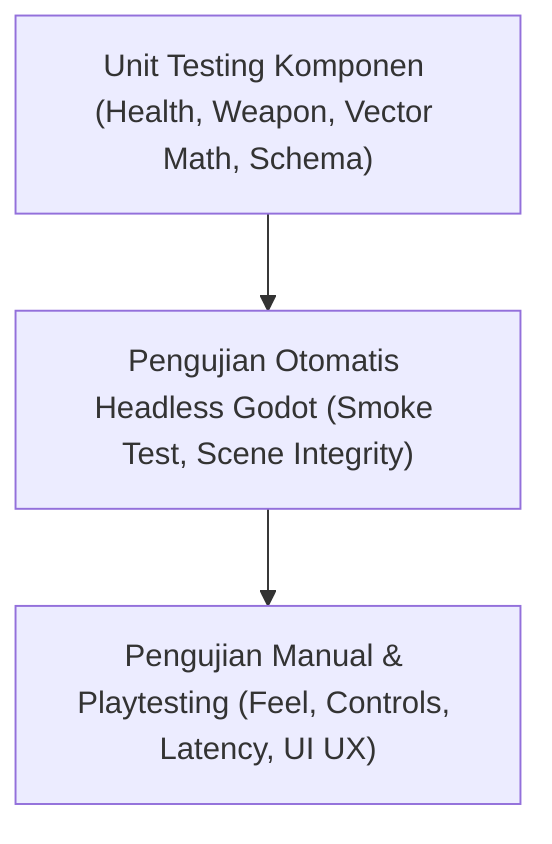

# Strategi & Manual Testing Battle Ground PC

Dokumen ini mendefinisikan framework pengujian, otomatisasi headless, dan checklist validasi manual untuk client PC Battle Ground.

## 1. Piramida Pengujian Kualitas



## 2. Pengujian Otomatis Headless (CLI)

Pengujian otomatis tanpa GUI memastikan tidak ada regresi kode yang lolos ke repository.

### 2.1. Menjalankan Smoke Test
Perintah eksekusi:
```powershell
& "C:\Users\GAMING DEVICES\AppData\Local\Microsoft\WinGet\Packages\GodotEngine.GodotEngine_Microsoft.Winget.Source_8wekyb3d8bbwe\Godot_v4.7.2-stable_win64_console.exe" --headless --path apps/pc-client -s tests/test_headless_smoke.gd
```

### 2.2. Cakupan Pengujian Smoke Test
- [x] Test 1: Autoload `GameDataLoader` memuat `character.json`, `weapons.json`, dan `arena.json`.
- [x] Test 2: Instansiasi scene `res://scenes/main/main.tscn` dan root orchestator.
- [x] Test 3: Instansiasi scene `res://scenes/arena/arena.tscn`, verifikasi node `Player`, `Health` (100 HP), dan `Weapon` (Pistol, 12 ammo).
- [x] Test 4: Kalkulasi pengurangan HP pada komponen `Health` saat menerima damage (100 HP - 20 = 80 HP).

### 2.3. Pengujian Keseluruhan Monorepo
Client PC terintegrasi dengan pengujian monorepo secara penuh:
- `npm run typecheck`: Validasi tipe statis TypeScript untuk `@battleground/shared`, `@battleground/server`, `@battleground/mobile`.
- `npm run lint`: Pemeriksaan standar gaya kode ESLint.
- `npm test`: 10/10 Jest unit test untuk fisika matematika dan endpoint Express backend.

## 3. Checklist Pengujian Manual & Playtesting

Gunakan checklist berikut saat memverifikasi gameplay di lingkungan desktop interaktif:

| Kategori | Item Pengujian | Ekspektasi Hasil | Status |
| :--- | :--- | :--- | :--- |
| **Menu Utama** | Peluncuran Game | Menampilkan judul "BATTLE GROUND", opsi Play, Settings, dan Quit | Valid |
| **Menu Utama** | Tombol Settings | Membuka panel dialog pengaturan display, audio, dan sensitivitas | Valid |
| **Arena** | Transisi Main Menu ke Arena | Scene arena termuat dalam waktu < 1 detik | Valid |
| **Kontrol** | Pergerakan WASD | Karakter bergerak bebas ke segala arah (360°) | Valid |
| **Kontrol** | Sprint (Shift) | Kecepatan meningkat terasa lebih cepat (450 px/s) | Valid |
| **Kontrol** | Dash (Spasi) | Karakter meluncur instan 700 px/s ke arah gerak selama 0.15s | Valid |
| **Kontrol** | Mouse Aiming | Karakter berputar mulus menghadap tepat ke ujung kursor mouse | Valid |
| **Kamera** | Camera Following | Kamera mengikuti pemain di tengah layar secara halus | Valid |
| **Pertempuran** | Tembak (LMB) | Mengeluarkan peluru tracer oranye dari moncong senjata | Valid |
| **Pertempuran** | Reload Manual (R) | Teks "RELOADING..." muncul di HUD, amunisi terisi kembali penuh | Valid |
| **Pertempuran** | Auto-Reload | Otomatis reload saat amunisi habis menjadi 0 | Valid |
| **Pertempuran** | Ganti Senjata (1, 2, 3) | Angka 1 (Pistol), 2 (Shotgun 6 pellet), 3 (Rifle cepat) | Valid |
| **Fisika** | Tabrakan Dinding Arena | Karakter tidak dapat menembus batas dinding luar | Valid |
| **Fisika** | Rintangan Balok | Karakter dan peluru tertahan oleh rintangan balok | Valid |
| **Combat Dummy** | Target Practice | Ditembak berkedip merah/putih, hancur setelah 3 hit pistol | Valid |
| **Skor & HUD** | Kill Counter | Setiap dummy yang hancur menambah skor +100 di HUD | Valid |
| **Pause Menu** | Tombol ESC | Membuka overlay pause; waktu dan pergerakan arena terhenti | Valid |
| **Pause Menu** | Resume / Restart | Tombol Resume melanjutkan permainan; Restart memuat ulang arena | Valid |

